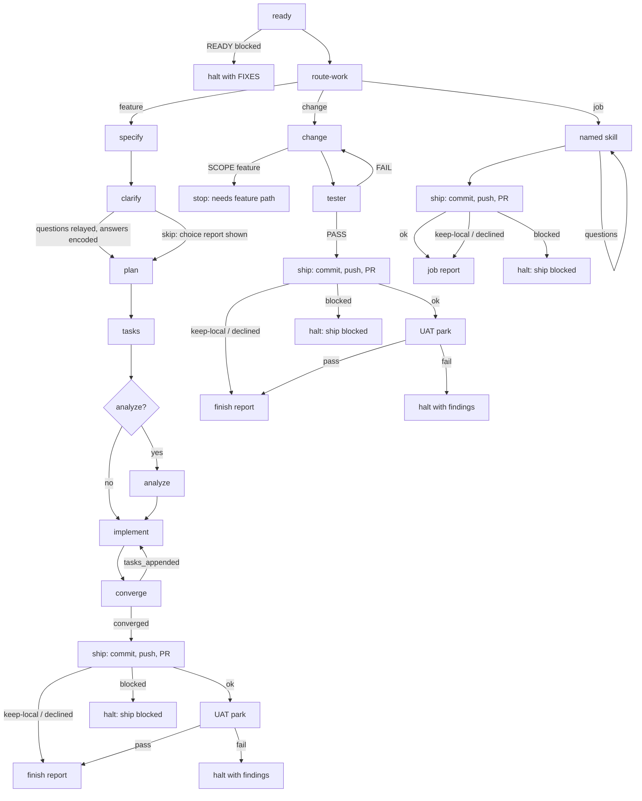

# Spec Kit orchestrator

This skill owns the control flow: ready, route, then one of three paths. It is
standalone and must not assume any project-specific workflow beyond the
project's Spec Kit skills and the global skills it names.

```text
ready → route-work ─┬─ feature → specify … converge → ship* → UAT
                    ├─ change  → change → tester → ship* → UAT
                    └─ job     → named skill → ship* (no UAT)
```

\* `ship` is automatic once validation passes; `keep-local` opts out. Merge is
manual and outside this loop.

Only **feature** uses the heavy Spec Kit machinery. **change** and **job** are
thin.

## Keywords

Treat these as command keywords when they appear in the user's `/speckit-orchestrate`
arguments or in a later reply during specify or clarify. Match case-insensitively.

- **skip** — A lone word `skip` counts; so do `skip questions` and
  `skip specify`. The user does not want to answer specify/clarify questions.
  Do not present the clarification question loop. Tell the specify and clarify
  workers not to ask; they document assumptions or pick recommended options and
  write those into the spec. After clarify, show the worker's **choice report**
  (what was chosen and why), then continue to plan. Do not treat `skip` as
  permission to skip plan, tasks, implement, or converge. `skip` has no effect
  on ship: ship is automatic after validation passes (see **Ship / UAT**).
- **keep-local** — A lone word `keep-local` (alias `no-ship`) opts this run out
  of shipping. After validation passes the parent leaves the work uncommitted
  in `WORKTREE`, emits `SHIP: declined`, and skips UAT. It is the only way to
  suppress the automatic ship; the default is to ship. Committing the work
  locally afterward is the operator's job.
- **path: feature|change|job** — the user chose the path. Pass it to route-work
  as `REQUESTED_PATH`; route-work must honor it.
- **skill: <name>** — the skill a job must use. Pass it to route-work as
  `REQUESTED_SKILL`.
- **worker: <pi-model>** — per-profile override for the Worker profile only
  (`implement`, `converge`, `change`, `job`). Accepts `provider/model`,
  `provider/model:thinking`, or full Pi flags (`--provider <p> --model <m>
  [--thinking <t>]`). Example: `worker: my-provider/my-exec-model`.
  Validated by launching Pi; never applied to Reasoning or Validation
  stages.
- **reasoning: <task-slug>** — per-profile override for the Reasoning profile
  only (`ready`, `route`, `specify`, `clarify`, `plan`, `tasks`, `analyze`;
  plan-reviewer when used = Reasoning, same model as plan). Must be a slug
  from the runtime's allowed Task model list. Example:
  `reasoning: my-reviewer-slug`. Never applied to Worker or Validation
  stages.
- **validation: <task-slug>** — per-profile override for the Validation profile
  only (`critic`, `tester`). Must be a slug from the runtime's allowed Task
  model list. Example: `validation: my-validator-slug`. Never applied to
  Worker or Reasoning stages.

## Parent vs worker (hard)

While this skill is running it outranks `pi-handoff`, `plan-orchestrator`, and
changelog/version bootstrap. Do not leave this pipeline to spawn Pi except for
worker stages (those stages are Pi-first). Do not run plan-orchestrator, or add
versioning the spec/tasks did not ask for. `pi-harness` has no default model —
worker stages MUST pass explicit `--provider` / `--model` / `--thinking`
resolved per run from **Model resolution** below (never a skill-pinned value).

The parent is a dispatcher. It MUST NOT execute ready, route, specify, clarify,
plan, tasks, analyze, implement, converge, change, tester, or a job skill
itself: not by following those skills in this session, not by writing their
artifacts, not by running `ready-check.sh`, not by editing code in-place
because context is already loaded.

Never omit `model`. Never pass `inherit` on Task launches. Ban
`inherit` for every reasoning- or validation-stage Task in this pipeline.

For reasoning stages the parent MUST launch a foreground `generalPurpose` Task
(`run_in_background: false`) with the **resolved** reasoning model from
**Model resolution** below (user override else runtime default — never a
skill-pinned slug, never `inherit`). Validation stages use the same host Task
launch with the **resolved** validation model, in a fresh session. For worker
stages the
parent MUST spawn the resolved worker backend (`pi-harness` or
`antigravity-harness`) with the resolved worker model flags; do not launch a
Task for those stages.

## flow_id

Before launching ready, mint an opaque `FLOW_ID` of the form
`flow_<timestamp>_<short-rand>`. Inject `FLOW_ID` into every worker prompt
(ready and all later stages). Every compact report MUST include a `FLOW_ID:`
line; parse it. This is prompt-scaffold only — do not edit project speckit
skills to teach them `flow_id`.

## Skill path resolution (AiNative-first)

`<AINATIVE>` is the AiNative repo root. Canonical source is always
`<AINATIVE>/docs/agents/<name>/SKILL.md`. Resolve hosts as:

| Host | Path (same file) |
| --- | --- |
| AiNative canonical | `<AINATIVE>/docs/agents/<name>/SKILL.md` |
| Cursor host | `~/.cursor/skills/<name>/SKILL.md` → canonical (symlink) |
| OpenCode host | `~/.config/opencode/skill/<name>/SKILL.md` → canonical (symlink) |
| Hermes worker | `/opt/data/mnt/AiNative/docs/agents/<name>/SKILL.md` (read-only mount) |

AiNative-owned skills below are named by their canonical `<AINATIVE>` path;
never assume the host `~/.cursor/...` spelling inside a worker prompt — pass
the canonical path and let the runtime resolve its symlink/mount. Spec Kit
project prompts are different: they live in the target repo at
`REPO_ROOT/.pi/prompts/speckit.<step>.md` (canonical), with
`REPO_ROOT/.cursor/skills/speckit-<step>/SKILL.md` as legacy fallback only.
`pr-generate/template.md` is the one exception: Cursor-only
(`~/.cursor/skills/pr-generate/`), not an AiNative agent — see Ship / UAT.

## Model resolution (runtime-owned, no pinned values)

This skill pins no provider, model, or thinking flag. Concrete values are
resolved per run from the runtime, per
`docs/systems/agentic-system.md` §2 Model: the active harness's Model Selection Config owns provider
and model selection; card profiles name execution profiles, not providers. Do
not put provider names or credentials in cards or in this skill.

Profiles (stage kinds, not model IDs):

| Profile | Stages |
| --- | --- |
| Reasoning | `ready`, `route`, `specify`, `clarify`, `plan`, `tasks`, `analyze` (host Task: Cursor `generalPurpose` Task, OpenCode subagent equivalent, or Hermes worker session). plan-reviewer when used = Reasoning, same model as plan. |
| Worker | `implement`, `converge`, `change`, `job` (Pi via `pi-harness` or Antigravity SDK via `antigravity-harness`) |
| Validation | `critic`, `tester` (host Task or equivalent, fresh session, validation model — distinct from plan/implement) |

Which profile fits which job is the authority of `docs/systems/agentic-system.md`
§2 Model; this skill only resolves concrete values per profile.

Resolution order for each profile, per run (each keyword/env affects only its own
profile — `worker:` never affects Reasoning or Validation stages, `reasoning:`
and `validation:` never affect Worker stages):

1. **Invocation keywords** — `worker: <pi-model>` sets the Worker profile
   only; `reasoning: <task-slug>` sets the Reasoning profile only;
   `validation: <task-slug>` sets the Validation profile only. Validate before
   use (Pi must launch; Task slug must be in the runtime's allowed list).
   Invalid value for that profile → STOP for that profile, say what was rejected
   and list what the runtime allows. Do not guess, do not cross-apply.
2. **Env override** — `SPECKIT_WORKER_MODEL` (Pi flags or `provider/model[:thinking]`,
   worker only), `SPECKIT_REASONING_MODEL` (Task slug, reasoning only),
   `SPECKIT_VALIDATION_MODEL` (Task slug, validation only). Same validation
   as keywords. Env beats runtime defaults but loses to invocation keywords.
3. **Runtime default** — otherwise use the runtime's configured default **per profile**:
   - Hermes: per-profile `config.yaml` model + card profile (`hermes kanban set-model`,
     `default` profile fallback). Keys live in Hermes
     (`$HERMES_DATA_ROOT/state/config.yaml`); this skill never invents them —
     read what `hermes config get model.*` / `hermes profile list` reports.
   - Cursor: reasoning = session default Task model (must be in the allowed Task
     model list); validation = a different allowed Task model for the session
     (fresh session for critic/tester); worker = operator-confirmed Pi provider/model (env or last
     working Pi flags). Set them independently in the session before invoking.
   - OpenCode: reasoning/validation = the configured subagent model for this
     session (validation distinct from reasoning);
     worker = same Pi provider/model mechanism as Cursor (Pi is external to
     both editors).
   Pass `--thinking` only when that profile's resolved source specifies it;
   never invent it.
4. **Unresolved** — if a profile has no usable value from 1–3, STOP before
   launching that profile and ask the operator for that profile's value only. Never
   invent a nearby slug, never reuse another profile's model.

## Worker SDK (Pi or Antigravity SDK)

Worker stages run in an external coding agent. The backend is the Worker
execution's `provider` (`SDK pi` vs `SDK antigravity`) — not a separate
decision. Resolve **one** provider per run (do not require both to be
installed). For Cursor/OpenCode that provider value lives in:

1. `SPECKIT_WORKER` (`pi` or `antigravity`; aliases `agy`, `google-antigravity`).
2. `git config speckit.worker` in the target repo.
3. Default `antigravity`.

Ready already reports `WORKER:` and `worker-runtime` as the echo of the
resolved provider. Honor that value for every later Worker-profile stage in
the same run.

- **pi** — follow `pi-harness`. Pass resolved `--provider` / `--model` /
  `--thinking`. `--cwd` is `WORKTREE` after ready.
- **antigravity** — follow `antigravity-harness` (`agy-spawn.py`, Google
  Antigravity Python SDK). Pass `--model` (required). Do not launch `agy`
  TUI, do not use npm `antigravity-sdk`. `--cwd` is `WORKTREE` after ready.

Do not swap backends mid-run because spawn failed. Same fallback rules as
the model: retry once only if the runtime defines a distinct fallback.

## Model access and fallback

The resolved value is always the first choice. Never invent nearby slugs.

**Worker stages** (`implement`, `converge`, `change`, `job`): spawn via the
resolved **Worker backend** (`pi-harness` or `antigravity-harness`). You stay in control; that agent is the worker. Give
it the same worker prompt this skill
would have given a Task (repo root, skill path, skip, report format,
`FLOW_ID`, `BRANCH` and `WORKTREE` when known); for any stage after ready, run
the worker with `--cwd` set to `WORKTREE`. Pass the resolved `--model` (and
Pi `--provider` / `--thinking` when the backend is Pi). Then continue from
the worker's compact report.

If the resolved worker launch cannot be used — binary/SDK missing, provider/auth
failure, spawn reject, or the launch fails because of the model — do not swap
to a Task or the other backend. Retry once only if the runtime defines a
distinct fallback value for that profile. If the primary partially executed the
stage before becoming unavailable, do not blindly rerun through the fallback:
inspect artifacts and side effects first and retry only when safe; otherwise stop
and report execution status and remaining work. If there is no runtime fallback, or
that fallback also fails, STOP (this is not a stuck retry of the primary).
Wait for the user to fix it.

**Reasoning stages** (`ready`, `route`, `specify`, `clarify`, `plan`, `tasks`,
`analyze`): launch a Task with the resolved Reasoning-profile model. Check the session's allowed Task model list
before launch. If the resolved value is missing from the list, Task rejects it, or the
launch fails because of the model, do not invent another slug: launch once
more only if the runtime defines a distinct fallback model. If there is no
runtime fallback, or the fallback also cannot be used, STOP
immediately. Do not continue to the next stage and do not count this as a
stuck retry. Wait for the user to fix it.

**Validation stages** (`critic`, `tester`): launch a fresh foreground host
Task with the resolved validation model — never continue a plan or implement
session. Same rules as reasoning stages: check the allowed Task model list,
never invent a slug, retry only a runtime-defined distinct fallback, and STOP
(that profile, not a stuck retry) if both the resolved value and the fallback
fail. Wait for the user to fix it.

Then tell the user, in plain language:

- which stage stopped
- which model slug or Pi flags were required
- what failed (no access, could not open, rejected slug, or worker report)
- the available slugs, if known

Do **not**: run any stage in the parent; pass or omit `inherit` on Tasks;
switch to Auto, Composer, Fast, or any nearby slug; retry the same
exact-slug or same Pi flags after a model-access failure; or keep a
reasoning- or validation-stage pipeline going so the user never sees the problem. Pi is the
worker runtime for worker stages is the resolved backend (Pi or Antigravity
SDK). Reasoning and validation stages
stay on the host Task mechanism (never Pi, never in-parent).

The parent MAY only: mint `FLOW_ID`, check prerequisites, dispatch workers,
parse reports, honor the keywords, relay a worker's queued questions to the
user one at a time (relay only; do not score or write the answer into files),
show the clarify choice report, run the pre-push guards, execute the automatic
ship (commit, push, PR) once validation passes unless the operator passed
`keep-local`, park feature/change runs for UAT, enforce stuck policy, and write
the finish report. Ship and UAT are parent-only
operations; workers remain ship-dumb on every path. It MAY read
worker reports, `git diff --stat`, and `quickstart.md` for that report. It MUST NOT read the
stage skills (AiNative `<AINATIVE>/docs/agents/...` or project Spec Kit prompts
`REPO_ROOT/.pi/prompts/speckit.*.md`, legacy `REPO_ROOT/.cursor/skills/speckit-{specify,clarify,plan,tasks,analyze,implement,converge}/SKILL.md`)
in order to perform those stages.

## Prerequisites

Before launching a worker, verify (AiNative-first; hosts resolve via symlink/mount per **Skill path resolution** above):

- Canonical AiNative skills (source of truth):
  - `<AINATIVE>/docs/agents/speckit-ready/SKILL.md`
  - `<AINATIVE>/docs/agents/speckit-ready/scripts/ready-check.sh`
    (Hermes: `/opt/data/mnt/AiNative/docs/agents/speckit-ready/scripts/ready-check.sh`)
  - `<AINATIVE>/docs/agents/route-work/SKILL.md`
  - `<AINATIVE>/docs/agents/change/SKILL.md` (covers `STEP: change` and `STEP: tester`)
  - `<AINATIVE>/docs/agents/pi-harness/SKILL.md` (Pi worker backend)
  - `<AINATIVE>/docs/agents/antigravity-harness/SKILL.md` (Antigravity SDK worker backend; required when `WORKER: antigravity`)
- The target repository contains `.specify/`
- `REPO_ROOT/.pi/prompts/speckit.specify.md` (Pi enrollment, canonical)
- the sibling project prompts needed for clarify, plan, tasks, analyze, implement, and
  converge (legacy fallback: `REPO_ROOT/.cursor/skills/speckit-*/SKILL.md`)

If a global skill/script is missing, or the repository is not a Spec Kit
project, stop and tell the user what is missing. Do not create the missing
project structure. Do not require a project-local `speckit-ready`.

## Pipeline

> Path resolution: AiNative skills resolve per **Skill path resolution**
> above (canonical `<AINATIVE>/docs/agents/<name>/SKILL.md`). Project Spec
> Kit prompts resolve to `REPO_ROOT/.pi/prompts/speckit.<step>.md`
> (canonical), with `REPO_ROOT/.cursor/skills/speckit-<step>/SKILL.md` as
> legacy fallback. Every bare `speckit-<step>` path below means the project
> Pi prompt first, Cursor legacy second — never an AiNative path (Spec Kit
> stages are not AiNative agents).



### Shared start

1. **Ready** — launch a `generalPurpose` worker with the resolved Reasoning-profile
   model. Tell it to follow the AiNative
   `<AINATIVE>/docs/agents/speckit-ready/SKILL.md` (not a project copy). Pass
   `REPO_ROOT`, `FLOW_ID`, and `FEATURE_DESCRIPTION` (user args verbatim).
   Ready runs against the original `REPO_ROOT` and never checks out the
   feature branch in the current worktree. Instead, it creates or reuses a
   dedicated git worktree for the feature branch (or reuses the current
   checkout when it is already on the feature branch). Nothing after ready
   runs unless the report says `READY: ok`. On `READY: blocked`, halt and
   show `CHECKS` + `FIXES`. If `READY: ok`, keep `BRANCH` **and** `WORKTREE`
   from the report; `WORKTREE` is the absolute path of the feature worktree
   (or `REPO_ROOT` itself when the checkout was already on the feature
   branch). A `READY: ok` report without a `WORKTREE:` line is unparseable —
   treat it under the stuck policy.

   From here on, every later stage (route, specify, …, change, job) must
   receive `WORKTREE` as its `REPO_ROOT`. If `WORKTREE` differs from the
   original `REPO_ROOT`, the parent MUST call cursor-app-control
   `move_agent_to_root` with that path **before** route and all later
   stages; skip the move when the two paths are the same.
2. **Route** — launch a `generalPurpose` worker with the resolved reasoning
   model. Tell it to follow
   `<AINATIVE>/docs/agents/route-work/SKILL.md`. Pass `REPO_ROOT` (the feature
   `WORKTREE` from ready), `FLOW_ID`,
   `TASK_DESCRIPTION` (user args verbatim), `REQUESTED_PATH`, and
   `REQUESTED_SKILL` (`none` when absent). Tell the user the route and `WHY`
   in one line, then take that path. For `ROUTE: job`, if `SKILL` is `none` or
   `SKILL_PATH` does not exist, stop and tell the user which skill is missing.

### Feature path

3. **Specify** — launch a `generalPurpose` worker with the resolved Reasoning-profile
   model. Tell it to follow the project's
   `REPO_ROOT/.pi/prompts/speckit.specify.md` exactly (legacy fallback:
   `REPO_ROOT/.cursor/skills/speckit-specify/SKILL.md`). Include `FLOW_ID`,
   `BRANCH`, and `WORKTREE` from ready, and pass `WORKTREE` as the
   worker's `REPO_ROOT`. When this prompt includes `FLOW_ID` + `BRANCH` +
   `WORKTREE`, **that instruction outranks the specify skill's
   `before_specify` hook for branch/worktree creation only**. Do not invoke
   git-extension branch create/switch: ready already created or reused the
   branch and its worktree. Still create the spec dir, `spec.md`, and
   `feature.json` as the skill says.
   Downstream stages use `FEATURE_DIR` / `feature.json` from specify; never
   infer the spec directory from `BRANCH`. It must make and document
   reasonable assumptions instead of waiting for its own clarification table;
   clarification happens in the clarify stage. If **skip** is active, tell the
   worker not to ask the user anything and to record assumptions in the spec.
   If the specify worker still presents questions, the parent MUST NOT wait on
   the user for those: answer them as assumptions and tell the worker to
   finish. The parent MUST NOT write `spec.md`.
4. **Clarify** — launch a `generalPurpose` worker with the resolved Reasoning-profile
   model, same rules as specify. Tell it to follow the
   project's `REPO_ROOT/.pi/prompts/speckit.clarify.md` exactly (legacy fallback:
   `REPO_ROOT/.cursor/skills/speckit-clarify/SKILL.md`). The parent
   MUST NOT write `spec.md`.

   **Default:** the worker must not wait inside the Task for answers. It
   returns the question queue (max 5) with `STATUS: blocked`. The parent asks
   the user those questions one at a time (relay only). After the last answer,
   resume or relaunch the worker with the answers so it encodes them into the
   spec.

   **If skip is active** (user said `skip` in arguments, during specify, or
   as the reply when questions would start): tell the worker not to ask. It
   builds the same question queue the skill would have asked (max 5), picks
   the recommended option using the skill's own recommendation rules, and
   writes those answers into the spec. The worker includes this in `SUMMARY`;
   the parent only displays it:

   ```text
   ## Choices I made (skip)

   For each question:
   - Q: <the question>
   - Chose: <option letter or short answer>
   - Why: <one or two sentences>
   ```

   **When clarify completes, go straight to plan.** Do not ask the user to
   confirm, do not wait for "continue", and do not pause after the choice
   report. There is no continuation gate in this run.
5. **Plan** — launch a `generalPurpose` worker with the resolved Reasoning-profile
   model (spawn like route; plan is a Reasoning-profile stage, not a Pi worker stage).
   It follows `REPO_ROOT/.pi/prompts/speckit.plan.md`
   (legacy fallback: `REPO_ROOT/.cursor/skills/speckit-plan/SKILL.md`)
   and returns the plan artifacts plus `ANALYZE: yes|no` and a one-line
   reason. Use `yes` for cross-cutting contracts, constitution tension, or
   many unknowns; use `no` for a small, local change. The parent MUST NOT
   write plan artifacts.
6. **Tasks** — launch a `generalPurpose` worker with the resolved Reasoning-profile
   model to follow `REPO_ROOT/.pi/prompts/speckit.tasks.md`
   (legacy fallback: `REPO_ROOT/.cursor/skills/speckit-tasks/SKILL.md`).
   The parent MUST NOT write `tasks.md`.
7. **Analyze** — only when plan returned `ANALYZE: yes`, launch a
   `generalPurpose` worker with the resolved reasoning model to follow
   `REPO_ROOT/.pi/prompts/speckit.analyze.md` (legacy fallback:
   `REPO_ROOT/.cursor/skills/speckit-analyze/SKILL.md`). This is read-only. Treat a
   critical finding as stuck and stop to ask the user; do not edit artifacts
   automatically. The parent MUST NOT perform the analysis.
8. **Implement ↔ converge** — start the loop with the resolved worker backend (`pi-harness` or `antigravity-harness`, resolved Worker-profile
   flags) for both implement and converge. Never launch these two workers in
   parallel. Continue until converge returns `CONVERGE_OUTCOME: converged`.
   `tasks_appended` with genuinely new tasks starts another implementation
   pass. Do not request user confirmation. The parent MUST NOT implement
   application code or append converge tasks itself.
9. **Ship / UAT** — after `CONVERGE_OUTCOME: converged`, run the shared
   **Ship / UAT** procedure below automatically. There is no ship confirmation
   prompt: unless the operator passed `keep-local`, the parent commits, pushes,
   and opens the PR, then parks for UAT; a UAT pass completes the run and a UAT
   failure halts with findings. On `SHIP: blocked`, halt with the blocker. On
   `keep-local` / `SHIP: declined`, finish with the report and skip UAT.

### Change path

3. **Change** — spawn the resolved worker backend (`pi-harness` or `antigravity-harness`) with the resolved worker
   flags. Tell it to follow `<AINATIVE>/docs/agents/change/SKILL.md`
   with `STEP: change`. Pass `REPO_ROOT` (the feature `WORKTREE` from
   ready), `FLOW_ID`, `BRANCH`, `TASK_DESCRIPTION`, and `ATTEMPT`. On
   `SCOPE: feature`, stop and tell the user the task needs the feature path
   (re-run with `path: feature`). Do not switch paths on your own.
4. **Tester** — launch a fresh `generalPurpose` worker with the
   resolved validation model (fresh session; never the change worker's model). Tell it to follow the same skill with
   `STEP: tester`, and pass the change report. On `TESTER: FAIL`, launch a new
   change worker with the `FINDINGS` and the next `ATTEMPT`, then test again.
   This counts toward the change step's stuck limit.
5. **Ship / UAT** — after `TESTER: PASS`, run the shared **Ship / UAT**
   procedure below automatically (no confirmation prompt). Unless the operator
   passed `keep-local`, the parent commits, pushes, and opens the PR, then parks
   for UAT; a UAT failure halts with findings; v1 does not loop back to
   implement. On `SHIP: blocked`, halt with the blocker.

### Job path

3. **Job** — spawn the resolved worker backend (`pi-harness` or `antigravity-harness`) with the resolved worker
   flags. Tell it to read `SKILL_PATH` from route-work and
   follow it exactly, with the user args verbatim as the task input, and
   pass `REPO_ROOT` (the feature `WORKTREE` from ready). Tell it to write
   outputs inside `REPO_ROOT` and not to commit, push, or open a pull
   request. If the skill needs answers from the user, the worker returns
   `STATUS: blocked` with a question queue; relay the questions one at a time
   and resume or relaunch the worker with the answers. If the worker reports
   the task is really a code change, stop and tell the user; do not switch
   paths on your own.
4. **Ship** — after `STATUS: ok`, run the shared **Ship / UAT** procedure
   below automatically (no confirmation prompt), unless the operator passed
   `keep-local`. For jobs, ship is the final action: do not run UAT.
5. **Complete** — report the skill used, the artifacts, and the PR URL when
   published.

## Ship / UAT (parent only; job skips UAT)

Feature enters this procedure after `CONVERGE_OUTCOME: converged`; change
enters after `TESTER: PASS`; job enters after `STATUS: ok`.

**Ship is automatic and asks no confirmation.** Once the path's validation
gate passes, the parent commits, pushes, and opens a PR. The PR *is* the
review surface: the operator reviews the concrete diff and walkthrough, not the
intent beforehand. Merge is never part of this loop — the parent never merges
anything, on any path. Human judgment keeps exactly two gates: UAT on the open
PR, and merge (outside the loop).

Opt out with the `keep-local` keyword (see **Keywords**): when present, skip
ship, emit `SHIP: declined`, and finish.

**Pre-push guards — all must hold before pushing; otherwise `SHIP: blocked`:**

- Path validation passed (feature: `CONVERGE_OUTCOME: converged`; change:
  `TESTER: PASS`; job: `STATUS: ok`).
- `BRANCH` is a topic branch, never a protected base branch (`main`, `master`,
  `develop`, `development`, or another protected name).
- The remote is the project's expected `origin`.
- No obvious secret material is staged (`.env`, credential files, keys). If
  found, stop and report rather than push.

**Ship action:**

- Commit and push from `WORKTREE` on `BRANCH` using Conventional Commits, then
  create a PR with `gh pr create`. Run Git as `git -C <WORKTREE>`.
- Never commit to or push the protected base branch.
- The PR body must follow the host PR template when present (Cursor-only:
  `~/.cursor/skills/pr-generate/template.md`, not an AiNative agent) and always
  include a mandatory `## Walkthrough` section with step-by-step human
  instructions. Source the walkthrough from plan test flows, `quickstart.md`,
  and the implement summary. Once a PR exists, the walkthrough is required, not
  optional — it is what the operator reviews.

After the parent completes the ship action, emit:

```text
SHIP: ok | blocked | declined
PR: <PR URL, or none>
WALKTHROUGH: <included | none | blocked>
SUMMARY: <what shipped, why it was kept local, or what blocked>
```

For feature and change only, `SHIP: ok` parks the run for operator UAT:

- **A — UAT pass:** complete the pipeline.
- **B — UAT fail:** halt with the findings. In v1, do not loop back to
  implement.

Do not run UAT after a job ship, nor after `SHIP: blocked` or `SHIP: declined`.
A ship failure is `SHIP: blocked`, not an implicit keep-local decision; report
the blocker and stop. `SHIP: declined` means only the `keep-local` opt-out.
Workers do not commit, push, create PRs, write walkthroughs, or perform UAT on
any path. Ship and UAT add no worker launch or model-resolution entry.

## Worker launches

Required `model` on every worker (always pass the resolved value; never omit
it; never pass `inherit` on Tasks). Resolve the value per run from **Model
resolution (runtime-owned, no pinned values)** above:

| Stage | Profile / spawn |
| --- | --- |
| ready, route, specify, clarify, plan, tasks, analyze | **Reasoning** — host Task with `model` = resolved Reasoning-profile model (plan-reviewer, when used, pinned to the same model as plan) |
| implement, converge, change, job | **Worker** — resolved backend (`pi-harness` or `antigravity-harness`) with resolved `--model` |
| critic, tester | **Validation** — host Task with `model` = resolved Validation-profile model, fresh session (distinct from Reasoning/Worker when available) |

Pass the resolved values exactly as resolved. If the resolved value for that
profile cannot be used, use the runtime's distinct fallback for that profile if one
exists; otherwise stop. If both the resolved value and the runtime fallback
fail, stop. Never substitute an invented slug or Pi model outside the
resolution order above.

Reasoning- and validation-stage workers must be a foreground `generalPurpose` Task with
`run_in_background: false` (or the host equivalent: OpenCode subagent /
Hermes worker session with the resolved reasoning or validation model;
validation always in a fresh session). Worker stages must run as the resolved backend via `pi-harness` or `antigravity-harness`.
Do not create or retain per-command agents.
Each worker starts with empty context, so include all of the following in its
prompt:

- `FLOW_ID`
- repository root — for every stage after ready this is the feature
  `WORKTREE` from ready, not the original `REPO_ROOT` — plus `BRANCH` and
  `FEATURE_DIR` when known (do not treat `BRANCH` as the spec directory)
- the user's arguments verbatim, including whether **skip** is active
  (if it is, the specify and clarify workers must not ask the user; document
  assumptions or pick recommended options)
- the current iteration or attempt number
- the relevant prior report (implement/converge summary, change report,
  tester findings)
- the relevant open tasks and findings
- the skill file to read and follow exactly (AiNative-first per **Skill path resolution**; hosts resolve via symlink/mount):
  - ready: `<AINATIVE>/docs/agents/speckit-ready/SKILL.md`
  - route: `<AINATIVE>/docs/agents/route-work/SKILL.md`
  - change / tester: `<AINATIVE>/docs/agents/change/SKILL.md` plus `STEP`
  - job: the `SKILL_PATH` from route-work (already AiNative-first resolved)
  - feature stages: the project's `REPO_ROOT/.pi/prompts/speckit-<step>.md`
    (legacy fallback: `REPO_ROOT/.cursor/skills/speckit-<step>/SKILL.md`)
- specify after ready: the `FLOW_ID` + `BRANCH` + `WORKTREE` precedence rule
  for `before_specify` (branch/worktree creation only)

Tell each worker to return its compact report in the format below (ready,
route, change, and tester use the formats in their own skills). Workers read
specification, plan, and task files from disk; do not paste those files into
their prompts.

Ready returns:

```text
READY: ok | blocked
FLOW_ID: <flow_id>
BRANCH: <branch-name-created-or-reused>
WORKTREE: <absolute feature worktree path, or REPO_ROOT when already on the branch>
CHECKS:
- [required] git-branch-state: pass|fail — <note>
- [required] speckit-layout: pass|fail — <note>
FIXES:
- <only when blocked>
```

Route returns:

```text
FLOW_ID: <flow_id>
ROUTE: feature | change | job
SKILL: <skill name, or none>
SKILL_PATH: <absolute path, or none>
WHY: <one or two sentences>
```

Feature stages and job return:

```text
FLOW_ID: <flow_id>
ARTIFACTS: <paths produced or updated>
STATUS: ok | stuck | blocked
SUMMARY: <one paragraph>
```

Implement returns:

```text
FLOW_ID: <flow_id>
IMPLEMENT_STATUS: completed | partial | failed | blocked
TASKS_DONE: <ids or "unknown">
TASKS_OPEN: <ids or "none">
BLOCKER: <none or one paragraph>
SUMMARY: <what was implemented; files touched; tests and result>
```

Converge returns:

```text
FLOW_ID: <flow_id>
CONVERGE_OUTCOME: converged | tasks_appended | blocked
FINDINGS: <none, or one line per finding: ID | gap-type | severity | source-ref | remaining work>
FINGERPRINT: <sorted source-refs joined by commas, or "none">
PHASE_APPENDED: <none or "Phase N">
TASKS_APPENDED: <none or new task IDs>
BLOCKER: <none or one paragraph>
SUMMARY: <counts checked; gap-type counts; whether tasks.md was written>
```

## Stuck policy

Track failures per step and iteration. A worker crash, empty or unparseable
report, unresolved implement failure, `TESTER: FAIL` after a change retry, or
repeated converge fingerprint is stuck. Retry the same step up to three
attempts total: the original attempt plus two resume or relaunch attempts
carrying the failure text and an instruction to fix it and finish. After the
third attempt, halt and ask the user. A repeated fingerprint is the same stuck
point even if the iteration number changed.

Ready and route worker crash or empty/unparseable report may use that
3-attempt retry. Do **not** retry a stable `READY: blocked` (required check
failed the same way a second time would: missing file, unsafe branch state,
ambiguous/unresolved base branch, malformed `ready.yml`).

Do not retry these cases:

- `READY: blocked` for a stable required-check failure — show `FIXES` and wait
- `ROUTE: job` with no usable skill — say which skill is missing and wait
- `SCOPE: feature` from a change worker — tell the user and wait
- missing `spec.md`, `plan.md`, or `tasks.md`
- a checklist gate where the user has not answered yes/proceed/continue
- a constitution or policy block requiring a human decision
- a worker explicitly asking the user a question it cannot answer
  (**exception:** specify/clarify questions while **skip** is active — tell
  the worker to self-answer and finish; do not halt. **exception:** a clarify
  or job worker that returned `STATUS: blocked` with a question queue — the
  parent relays those questions to the user, then resumes the worker with the
  answers; that is not stuck)
- a Reasoning- or Validation-profile stage resolved model and its runtime fallback both remain unavailable,
  inaccessible, or could not be opened (see **Model access and fallback**)
- a Worker-profile stage resolved Pi flags and runtime fallback both failed (Pi missing, provider
  or auth failure, job hung, or unusable report)

For these cases, stop immediately and tell the user the prerequisite,
decision, or model problem required.

Treat `CONVERGE_OUTCOME: blocked` as an immediate stop. Treat
`CONVERGE_OUTCOME: tasks_appended` as progress only when it adds new remaining
work; an unchanged fingerprint follows the stuck policy. Only
`CONVERGE_OUTCOME: converged` is a successful exit.

During the loop, keep updates short: iteration number, implement status,
converge outcome, and finding count. On `CONVERGE_OUTCOME: converged`, state
that the feature satisfies the specification, plan, and tasks, give the number
of iterations, then proceed to the automatic ship (and UAT when ship
succeeds). On a stop, state the failed step, attempt count,
worker report, actions already tried, and what the user must do next.

Do not handle constitution, checklist, taskstoissues, or other commands outside
this pipeline.
