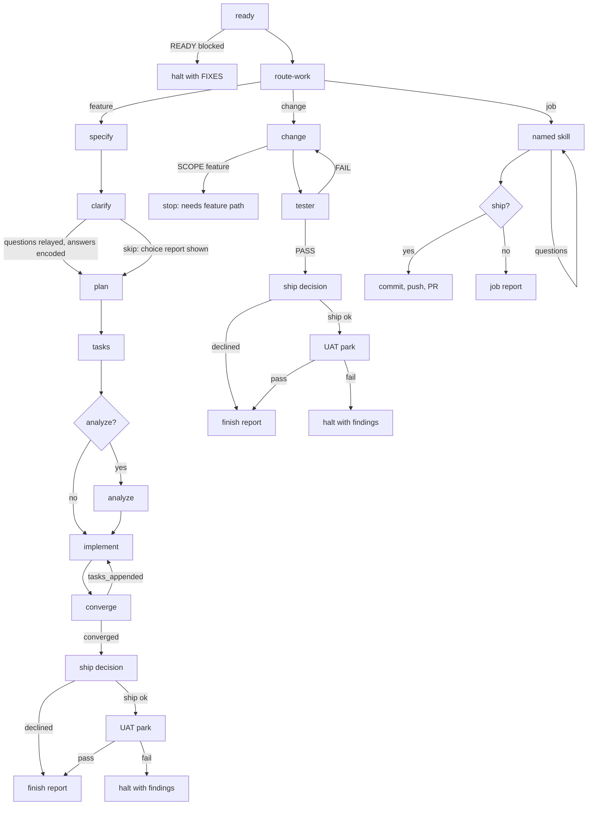

# Spec Kit orchestrator

This skill owns the control flow: ready, route, then one of three paths. It is
standalone and must not assume any project-specific workflow beyond the
project's Spec Kit skills and the global skills it names.

```text
ready → route-work ─┬─ feature → specify … converge → ship → UAT
                    ├─ change  → change → tester → ship → UAT
                    └─ job     → named skill → ship (no UAT)
```

Only **feature** uses the heavy Spec Kit machinery. **change** and **job** are
thin.

## Keywords

Treat these as command keywords when they appear in the user's `/speckit-orchestrate`
arguments or in a later reply during specify or clarify. Match case-insensitively.

- **skip** — A lone word `skip` counts; so do `skip questions` and
  `skip specify`. The user does not want to answer specify/clarify questions.
  Do not present the clarification question loop. Tell the specify and clarify
  workers not to ask; they document assumptions or pick recommended options and
  write those into the spec. After clarify, show the worker's **choice report**
  (what was chosen and why), then continue to plan. Do not treat `skip` as
  permission to skip plan, tasks, implement, or converge. `skip` does not
  answer the ship decision or authorize shipping; the parent must still ask.
- **path: feature|change|job** — the user chose the path. Pass it to route-work
  as `REQUESTED_PATH`; route-work must honor it.
- **skill: <name>** — the skill a job must use. Pass it to route-work as
  `REQUESTED_SKILL`.

## Parent vs worker (hard)

While this skill is running it outranks `pi-handoff`, `plan-orchestrator`, and
changelog/version bootstrap. Do not leave this pipeline to spawn Pi except for
Luna stages (those stages are Pi-first). Do not run plan-orchestrator, or add
versioning the spec/tasks did not ask for. `pi-harness` has no default model —
Luna stages MUST pass the registry Pi flags as `--provider` / `--model` /
`--thinking`.

The parent is a dispatcher. It MUST NOT execute ready, route, specify, clarify,
plan, tasks, analyze, implement, converge, change, tester, or a job skill
itself: not by following those skills in this session, not by writing their
artifacts, not by running `ready-check.sh`, not by editing code in-place
because context is already loaded.

Never omit `model`. Never pass `inherit` on Cursor Task launches. Ban
`inherit` for every Grok-stage Task in this pipeline.

For Grok stages the parent MUST launch a foreground `generalPurpose` Task
(`run_in_background: false`) with the **exact** Grok Task slug from the
registry, unless the Grok substitute below applies. For Luna stages the
parent MUST spawn Pi via `pi-harness` with the Luna Pi primary flags; do
not launch a Cursor Task for those stages.

## flow_id

Before launching ready, mint an opaque `FLOW_ID` of the form
`flow_<timestamp>_<short-rand>`. Inject `FLOW_ID` into every worker prompt
(ready and all later stages). Every compact report MUST include a `FLOW_ID:`
line; parse it. This is prompt-scaffold only — do not edit project speckit
skills to teach them `flow_id`.

## Model registry (edit here only)

The only place in this skill that spells out the model values. Copy these
values onto Task `model` / the Pi flags; never invent nearby slugs.

| Role | Value |
| --- | --- |
| Luna Pi primary | `--provider opencode --model mimo-v2.6-flash-free --thinking xhigh` |
| Luna Pi fallback | `--provider opencode-go --model mimo-v2.6-flash --thinking xhigh` |
| Grok Task slug | `muse-spark-1.3-max` |
| Grok substitute | `cursor-grok-4.6-medium` |

## Model access and fallback

The registry value is always the first choice. Copy it; never invent nearby
slugs.

If the user named a Cursor Task slug that is in the allowed list, use that
slug for Grok-stage launches instead of the registry. If they named a Pi
provider/model, use that only on Luna-stage Pi launches. If they named a model
that is neither an allowed Task slug nor a Pi model, stop and say so. Do not
guess.

**Luna stages** (`ready`, `specify`, `clarify`, `plan`, `tasks`, `implement`,
`change`, `job`): spawn as a Pi sub-agent. Follow the `pi-harness` skill. You
stay in control; Pi is the worker. Give Pi the same worker prompt this skill
would have given a Task (repo root, skill path, skip, report format,
`FLOW_ID`, `BRANCH` and `WORKTREE` when known); for any stage after ready, run
Pi with `--cwd` set to `WORKTREE` so it lands in the feature worktree. Pass
the Luna Pi primary flags from the registry on the Pi command line, unless the
user named a Pi model. Then continue the pipeline from Pi's compact report.

If the primary Pi launch cannot be used — Pi missing, provider/auth failure,
spawn reject, or the launch fails because of the model — do not swap to a
Cursor Task. Retry once with the Luna Pi fallback flags. If that fallback
also fails, STOP (this is not a stuck retry of the primary). Wait for the
user to fix it.

**Grok stages** (`route`, `analyze`, `converge`, `tester`): launch a Cursor
Task with the Grok Task slug. Check the session's allowed Task model list
before launch. If that slug is missing from the list, Task rejects it, or the
launch fails because of the model, do not invent another slug: launch once
more with the Grok substitute. If the substitute also cannot be used, STOP
immediately. Do not continue to the next stage and do not count this as a
stuck retry. Wait for the user to fix it.

Then tell the user, in plain language:

- which stage stopped
- which model slug or Pi flags were required
- what failed (no access, could not open, rejected slug, or worker report)
- the available slugs, if known

Do **not**: run any stage in the parent; pass or omit `inherit` on Tasks;
switch to Auto, Composer, Fast, or any nearby slug; retry the same
exact-slug or same Pi flags after a model-access failure; or keep a
Grok-stage pipeline going so the user never sees the problem. Pi is the
only worker runtime for Luna stages. Grok stages stay on Cursor Task.

The parent MAY only: mint `FLOW_ID`, check prerequisites, dispatch workers,
parse reports, honor the keywords, relay a worker's queued questions to the
user one at a time (relay only; do not score or write the answer into files),
show the clarify choice report, ask the shared ship decision, execute ship,
park feature/change runs for UAT, ask the job ship decision and carry it out,
enforce stuck policy, and write the finish report. Ship and UAT are parent-only
operations; workers remain ship-dumb on every path. It MAY read
worker reports, `git diff --stat`, and `quickstart.md` for that report. It MUST NOT read the
stage skills or the project Spec Kit prompts
(`.pi/prompts/speckit.*.md`, legacy `.cursor/skills/speckit-{specify,clarify,plan,tasks,analyze,implement,converge}/SKILL.md`)
in order to perform those stages.

## Prerequisites

Before launching a worker, verify:

- Canonical skills (AiNative source of truth; host `~/.cursor/skills/<name>`
  symlinks resolve here):
  - `<AINATIVE>/docs/agents/speckit-ready/SKILL.md`
  - `<AINATIVE>/docs/agents/speckit-ready/scripts/ready-check.sh`
  - `<AINATIVE>/docs/agents/route-work/SKILL.md`
  - `<AINATIVE>/docs/agents/change/SKILL.md`
- The target repository contains `.specify/`
- `.pi/prompts/speckit.specify.md` (Pi enrollment, canonical)
- the sibling prompts needed for clarify, plan, tasks, analyze, implement, and
  converge (legacy fallback: `.cursor/skills/speckit-*/SKILL.md`)

If a global skill/script is missing, or the repository is not a Spec Kit
project, stop and tell the user what is missing. Do not create the missing
project structure. Do not require a project-local `speckit-ready`.

## Pipeline

> Path resolution: project Spec Kit prompts live at `.pi/prompts/speckit.<step>.md`
> (Pi enrollment, canonical). Every `.cursor/skills/speckit-<step>/SKILL.md`
> path below means the Pi prompt first, with the Cursor path as legacy
> fallback. Host `~/.cursor/skills/<name>` paths resolve via symlink to the
> AiNative canonical files.



### Shared start

1. **Ready** — spawn Pi via `pi-harness` with the Luna Pi primary
   flags. Tell it to follow the **global**
   `~/.cursor/skills/speckit-ready/SKILL.md` (not a project copy). Pass
   `REPO_ROOT`, `FLOW_ID`, and `FEATURE_DESCRIPTION` (user args verbatim).
   Ready runs against the original `REPO_ROOT` and never checks out the
   feature branch in the current worktree. Instead, it creates or reuses a
   dedicated git worktree for the feature branch (or reuses the current
   checkout when it is already on the feature branch). Nothing after ready
   runs unless the report says `READY: ok`. On `READY: blocked`, halt and
   show `CHECKS` + `FIXES`. If `READY: ok`, keep `BRANCH` **and** `WORKTREE`
   from the report; `WORKTREE` is the absolute path of the feature worktree
   (or `REPO_ROOT` itself when the checkout was already on the feature
   branch). A `READY: ok` report without a `WORKTREE:` line is unparseable —
   treat it under the stuck policy.

   From here on, every later stage (route, specify, …, change, job) must
   receive `WORKTREE` as its `REPO_ROOT`. If `WORKTREE` differs from the
   original `REPO_ROOT`, the parent MUST call cursor-app-control
   `move_agent_to_root` with that path **before** route and all later
   stages; skip the move when the two paths are the same.
2. **Route** — launch a `generalPurpose` worker with the Grok
   Task slug. Tell it to follow
   `~/.cursor/skills/route-work/SKILL.md`. Pass `REPO_ROOT` (the feature
   `WORKTREE` from ready), `FLOW_ID`,
   `TASK_DESCRIPTION` (user args verbatim), `REQUESTED_PATH`, and
   `REQUESTED_SKILL` (`none` when absent). Tell the user the route and `WHY`
   in one line, then take that path. For `ROUTE: job`, if `SKILL` is `none` or
   `SKILL_PATH` does not exist, stop and tell the user which skill is missing.

### Feature path

3. **Specify** — spawn Pi via `pi-harness` with the Luna Pi primary
   flags. Tell it to follow the project's
   `.cursor/skills/speckit-specify/SKILL.md` exactly. Include `FLOW_ID`,
   `BRANCH`, and `WORKTREE` from ready, and pass `WORKTREE` as the
   worker's `REPO_ROOT`. When this prompt includes `FLOW_ID` + `BRANCH` +
   `WORKTREE`, **that instruction outranks the specify skill's
   `before_specify` hook for branch/worktree creation only**. Do not invoke
   git-extension branch create/switch: ready already created or reused the
   branch and its worktree. Still create the spec dir, `spec.md`, and
   `feature.json` as the skill says.
   Downstream stages use `FEATURE_DIR` / `feature.json` from specify; never
   infer the spec directory from `BRANCH`. It must make and document
   reasonable assumptions instead of waiting for its own clarification table;
   clarification happens in the clarify stage. If **skip** is active, tell the
   worker not to ask the user anything and to record assumptions in the spec.
   If the specify worker still presents questions, the parent MUST NOT wait on
   the user for those: answer them as assumptions and tell the worker to
   finish. The parent MUST NOT write `spec.md`.
4. **Clarify** — spawn Pi via `pi-harness` with the Luna Pi primary
   flags, same rules as specify. Tell it to follow the
   project's `.cursor/skills/speckit-clarify/SKILL.md` exactly. The parent
   MUST NOT write `spec.md`.

   **Default:** the worker must not wait inside the Task for answers. It
   returns the question queue (max 5) with `STATUS: blocked`. The parent asks
   the user those questions one at a time (relay only). After the last answer,
   resume or relaunch the worker with the answers so it encodes them into the
   spec.

   **If skip is active** (user said `skip` in arguments, during specify, or
   as the reply when questions would start): tell the worker not to ask. It
   builds the same question queue the skill would have asked (max 5), picks
   the recommended option using the skill's own recommendation rules, and
   writes those answers into the spec. The worker includes this in `SUMMARY`;
   the parent only displays it:

   ```text
   ## Choices I made (skip)

   For each question:
   - Q: <the question>
   - Chose: <option letter or short answer>
   - Why: <one or two sentences>
   ```

   **When clarify completes, go straight to plan.** Do not ask the user to
   confirm, do not wait for "continue", and do not pause after the choice
   report. There is no continuation gate in this run.
5. **Plan** — spawn Pi via `pi-harness` with the Luna Pi primary
   flags. It follows `.cursor/skills/speckit-plan/SKILL.md`
   and returns the plan artifacts plus `ANALYZE: yes|no` and a one-line
   reason. Use `yes` for cross-cutting contracts, constitution tension, or
   many unknowns; use `no` for a small, local change. The parent MUST NOT
   write plan artifacts.
6. **Tasks** — spawn Pi via `pi-harness` with the Luna Pi primary
   flags to follow `.cursor/skills/speckit-tasks/SKILL.md`.
   The parent MUST NOT write `tasks.md`.
7. **Analyze** — only when plan returned `ANALYZE: yes`, launch a
   `generalPurpose` worker with the Grok Task slug to follow
   `.cursor/skills/speckit-analyze/SKILL.md`. This is read-only. Treat a
   critical finding as stuck and stop to ask the user; do not edit artifacts
   automatically. The parent MUST NOT perform the analysis.
8. **Implement ↔ converge** — start the loop with Pi (`pi-harness`, Luna
   Pi primary flags) for implement and a `generalPurpose` Task with the Grok
   Task slug for converge. Never launch these two workers in
   parallel. Continue until converge returns `CONVERGE_OUTCOME: converged`.
   `tasks_appended` with genuinely new tasks starts another implementation
   pass. Do not request user confirmation. The parent MUST NOT implement
   application code or append converge tasks itself.
9. **Ship / UAT** — after `CONVERGE_OUTCOME: converged`, use the shared
   **Ship / UAT** procedure below. On ship decline, finish with the report.
   On ship success, park for UAT; a UAT pass completes the run and a UAT
   failure halts with findings.

### Change path

3. **Change** — spawn Pi via `pi-harness` with the Luna Pi primary
   flags. Tell it to follow `~/.cursor/skills/change/SKILL.md`
   with `STEP: change`. Pass `REPO_ROOT` (the feature `WORKTREE` from
   ready), `FLOW_ID`, `BRANCH`, `TASK_DESCRIPTION`, and `ATTEMPT`. On
   `SCOPE: feature`, stop and tell the user the task needs the feature path
   (re-run with `path: feature`). Do not switch paths on your own.
4. **Tester** — launch a fresh `generalPurpose` worker with the
   Grok Task slug. Tell it to follow the same skill with
   `STEP: tester`, and pass the change report. On `TESTER: FAIL`, launch a new
   change worker with the `FINDINGS` and the next `ATTEMPT`, then test again.
   This counts toward the change step's stuck limit.
5. **Ship / UAT** — after `TESTER: PASS`, use the shared **Ship / UAT**
   procedure below. On ship decline, finish with the report. On ship success,
   park for UAT; a UAT failure halts with findings; v1 does not loop back to
   implement.

### Job path

3. **Job** — spawn Pi via `pi-harness` with the Luna Pi primary
   flags. Tell it to read `SKILL_PATH` from route-work and
   follow it exactly, with the user args verbatim as the task input, and
   pass `REPO_ROOT` (the feature `WORKTREE` from ready). Tell it to write
   outputs inside `REPO_ROOT` and not to commit, push, or open a pull
   request. If the skill needs answers from the user, the worker returns
   `STATUS: blocked` with a question queue; relay the questions one at a time
   and resume or relaunch the worker with the answers. If the worker reports
   the task is really a code change, stop and tell the user; do not switch
   paths on your own.
4. **Ship decision** — after `STATUS: ok`, use the shared **Ship / UAT**
   procedure below. For jobs, ship is the final action: do not run UAT.
5. **Complete** — report the skill used, the artifacts, and the PR URL when
   published.

## Ship / UAT (parent only; job skips UAT)

Feature enters this procedure after `CONVERGE_OUTCOME: converged`; change
enters after `TESTER: PASS`; job enters after `STATUS: ok`. The parent asks the
operator once:

- **A — ship:** commit and push from `WORKTREE` on `BRANCH` using Conventional
  Commits, then create a PR with `gh pr create`. Run Git as
  `git -C <WORKTREE>` and never commit to or push the protected base branch
  (`main`, `master`, `develop`, `development`, or another protected name).
  The PR body must follow `~/.cursor/skills/pr-generate/template.md` and include
  a mandatory `## Walkthrough` section with step-by-step human instructions.
  Source the walkthrough from plan test flows, `quickstart.md`, and the
  implement summary. Once a PR exists, the walkthrough is required, not
  optional.
- **B — keep local:** leave files uncommitted; skip UAT. This is the only
  meaning of a declined ship decision.

After the parent completes the ship action, emit:

```text
SHIP: ok | blocked | declined
PR: <PR URL, or none>
WALKTHROUGH: <included | none | blocked>
SUMMARY: <what shipped or why it was kept/blocked>
```

For feature and change only, `SHIP: ok` parks the run for operator UAT:

- **A — UAT pass:** complete the pipeline.
- **B — UAT fail:** halt with the findings. In v1, do not loop back to
  implement.

Do not run UAT after a job ship. A ship failure is `SHIP: blocked`, not an
implicit keep-local decision; report the blocker and stop. Workers do not
commit, push, create PRs, write walkthroughs, or perform UAT on any path. Ship
and UAT add no worker launch or model-registry entry.

## Worker launches

Required `model` on every worker (always pass the registry value; never omit
it; never pass `inherit` on Tasks). Copy the values by role from **Model
registry (edit here only)** above:

| Stage | worker |
| --- | --- |
| ready, specify, clarify, plan, tasks, implement, change, job | Pi with Luna Pi primary flags |
| route, analyze, converge, tester | Task `model` = Grok Task slug |

Pass the registry values exactly as written. If Luna Pi primary cannot be
used, use Luna Pi fallback. If the Grok Task slug cannot be used, use the
Grok substitute. If both values for that role fail, stop. Never substitute a
different Cursor slug or Pi model than the registry.

Grok-stage workers must be a foreground `generalPurpose` Task with
`run_in_background: false`. Luna-stage workers must be Pi via `pi-harness`.
Do not create or retain per-command Cursor agents.
Each worker starts with empty context, so include all of the following in its
prompt:

- `FLOW_ID`
- repository root — for every stage after ready this is the feature
  `WORKTREE` from ready, not the original `REPO_ROOT` — plus `BRANCH` and
  `FEATURE_DIR` when known (do not treat `BRANCH` as the spec directory)
- the user's arguments verbatim, including whether **skip** is active
  (if it is, the specify and clarify workers must not ask the user; document
  assumptions or pick recommended options)
- the current iteration or attempt number
- the relevant prior report (implement/converge summary, change report,
  tester findings)
- the relevant open tasks and findings
- the skill file to read and follow exactly:
  - ready: `~/.cursor/skills/speckit-ready/SKILL.md`
  - route: `~/.cursor/skills/route-work/SKILL.md`
  - change / tester: `~/.cursor/skills/change/SKILL.md` plus `STEP`
  - job: the `SKILL_PATH` from route-work
  - feature stages: the project's `.cursor/skills/speckit-<step>/SKILL.md`
- specify after ready: the `FLOW_ID` + `BRANCH` + `WORKTREE` precedence rule
  for `before_specify` (branch/worktree creation only)

Tell each worker to return its compact report in the format below (ready,
route, change, and tester use the formats in their own skills). Workers read
specification, plan, and task files from disk; do not paste those files into
their prompts.

Ready returns:

```text
READY: ok | blocked
FLOW_ID: <flow_id>
BRANCH: <branch-name-created-or-reused>
WORKTREE: <absolute feature worktree path, or REPO_ROOT when already on the branch>
CHECKS:
- [required] git-branch-state: pass|fail — <note>
- [required] speckit-layout: pass|fail — <note>
FIXES:
- <only when blocked>
```

Route returns:

```text
FLOW_ID: <flow_id>
ROUTE: feature | change | job
SKILL: <skill name, or none>
SKILL_PATH: <absolute path, or none>
WHY: <one or two sentences>
```

Feature stages and job return:

```text
FLOW_ID: <flow_id>
ARTIFACTS: <paths produced or updated>
STATUS: ok | stuck | blocked
SUMMARY: <one paragraph>
```

Implement returns:

```text
FLOW_ID: <flow_id>
IMPLEMENT_STATUS: completed | partial | failed | blocked
TASKS_DONE: <ids or "unknown">
TASKS_OPEN: <ids or "none">
BLOCKER: <none or one paragraph>
SUMMARY: <what was implemented; files touched; tests and result>
```

Converge returns:

```text
FLOW_ID: <flow_id>
CONVERGE_OUTCOME: converged | tasks_appended | blocked
FINDINGS: <none, or one line per finding: ID | gap-type | severity | source-ref | remaining work>
FINGERPRINT: <sorted source-refs joined by commas, or "none">
PHASE_APPENDED: <none or "Phase N">
TASKS_APPENDED: <none or new task IDs>
BLOCKER: <none or one paragraph>
SUMMARY: <counts checked; gap-type counts; whether tasks.md was written>
```

## Stuck policy

Track failures per step and iteration. A worker crash, empty or unparseable
report, unresolved implement failure, `TESTER: FAIL` after a change retry, or
repeated converge fingerprint is stuck. Retry the same step up to three
attempts total: the original attempt plus two resume or relaunch attempts
carrying the failure text and an instruction to fix it and finish. After the
third attempt, halt and ask the user. A repeated fingerprint is the same stuck
point even if the iteration number changed.

Ready and route worker crash or empty/unparseable report may use that
3-attempt retry. Do **not** retry a stable `READY: blocked` (required check
failed the same way a second time would: missing file, unsafe branch state,
ambiguous/unresolved base branch, malformed `ready.yml`).

Do not retry these cases:

- `READY: blocked` for a stable required-check failure — show `FIXES` and wait
- `ROUTE: job` with no usable skill — say which skill is missing and wait
- `SCOPE: feature` from a change worker — tell the user and wait
- missing `spec.md`, `plan.md`, or `tasks.md`
- a checklist gate where the user has not answered yes/proceed/continue
- a constitution or policy block requiring a human decision
- a worker explicitly asking the user a question it cannot answer
  (**exception:** specify/clarify questions while **skip** is active — tell
  the worker to self-answer and finish; do not halt. **exception:** a clarify
  or job worker that returned `STATUS: blocked` with a question queue — the
  parent relays those questions to the user, then resumes the worker with the
  answers; that is not stuck)
- a Grok-stage required model and its substitute both remain unavailable,
  inaccessible, or could not be opened (see **Model access and fallback**)
- a Luna-stage Pi primary and Pi fallback both failed (Pi missing, provider
  or auth failure, job hung, or unusable report)

For these cases, stop immediately and tell the user the prerequisite,
decision, or model problem required.

Treat `CONVERGE_OUTCOME: blocked` as an immediate stop. Treat
`CONVERGE_OUTCOME: tasks_appended` as progress only when it adds new remaining
work; an unchanged fingerprint follows the stuck policy. Only
`CONVERGE_OUTCOME: converged` is a successful exit.

During the loop, keep updates short: iteration number, implement status,
converge outcome, and finding count. On `CONVERGE_OUTCOME: converged`, state
that the feature satisfies the specification, plan, and tasks, give the number
of iterations, then proceed to the shared ship decision (and UAT when the
operator ships). On a stop, state the failed step, attempt count,
worker report, actions already tried, and what the user must do next.

Do not handle constitution, checklist, taskstoissues, or other commands outside
this pipeline.
