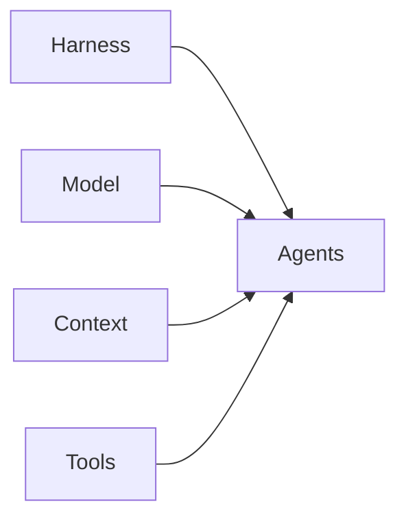

# Agentic system

Every agentic system has five parts. For managed projects, AiNative defines
the methodology and Hermes is the control plane that dispatches work through
its native Kanban board and worker profiles. That loop is **target design, not
wired into the current install**. Keep runtime configuration in Hermes and
project-specific context in the project.

| Part | What it is | Source of truth |
|------|------------|-----------------|
| [Harness](#1-harness) | Runtime and isolation for managed work | [feature-loop.md](./feature-loop.md), Hermes configuration |
| [Model](#2-model) | Model selection for each state | Harness Model Selection Config (per harness) |
| [Context](#3-context) | Project rules, specs, and methodology | Project `AGENTS.md`, `.ainative/project.yaml`, and this repository |
| [Tools](#4-tools) | Capabilities available to workers and control plane | Worker contract and Hermes configuration |
| [Agents](#5-agents) | Per-state skills and job-worker instructions | [agents/](../agents/) |



The target managed-project workflow is [feature-loop.md](./feature-loop.md)
(not wired into the current install). [agentic-coding.md](./agentic-coding.md)
documents the historical PIV methodology; do not treat it as a second live
workflow.

---

## 1. Harness

The managed-project runtime is the Hermes agent (the `personalAgent` install).
Hermes owns the board, worktree isolation, state transitions, human gates
(UAT and merge), and the automatic ship step. In the target design it starts
one fresh worker session for
each agent state, in the task worktree; the current install has no worker loop
wired.

Workers return a compact report and exit. They do not own the workflow,
board, GitHub shipping, or deployment. Runtime details are in
[feature-loop.md](./feature-loop.md) and the live install: `personalAgent`
(Compose, image, environment) plus the private Hermes home, where Hermes
writes its own context.

---

## 2. Model

Model choice is a system decision, not a default. The workflow defines
exactly three fixed, universal profiles. Every workflow state that executes
a model maps to exactly one profile. States that execute no model
(`ship` and `uat` — parent/control-plane and human-only) need no model
resolution.

| Profile | Job | Workflow states |
|------|-----|-----------------|
| **Reasoning** | Analyze information, clarify requirements, plan, structure work, and make decisions | `ready`, `route`, `specify`, `clarify`, `plan`, `tasks`, `analyze` |
| **Worker** | Execute assigned instructions and produce or modify artifacts | `implement`, `converge`, and workers executing an assigned `change` or `job` task |
| **Validation** | Independently challenge work, review correctness, and verify requirements | `critic`, `tester` |

`plan-reviewer` is a planning-only second pass at the end of planning. It
deliberately uses the Reasoning model (same model as the planner). It is not
a Validation state and not a substitute for the Validation profile
([validation-layer.md](./validation-layer.md#model-selection)).

Model names change as providers ship newer versions, so no concrete provider
or model is pinned here — not even a slug. The three profiles stay stable;
concrete values are resolved per run from the active harness's Model
Selection Config and may be overridden per task once dispatch is wired.

Resolution follows this conceptual chain:

```text
Workflow State → Universal Profile → Harness Model Selection Config → Harness Adapter → Execution
```

### Harness Model Selection Config

Each supported harness (Cursor, OpenCode, Hermes) has its own Harness Model
Selection Config. The workflow stays independent of harnesses and concrete
model names; only the config names them.

Per profile, the config contains:

- **Primary:** exactly one execution configuration.
- **Fallback:** zero or one optional execution configuration.

Each configured execution specifies:

- `executionMode`
- `provider`
- `modelId`

Supported `executionMode` values:

- `HOST` — execute through the harness's native model-selection and
  execution mechanism.
- `SDK` — execute through an explicit provider SDK/API integration.

Primary and fallback may use different modes, providers, and model IDs.

The harness adapter handles model selection in `HOST` mode: it must select
or verify the effective model according to the capabilities of that
harness. Do not assume every harness exposes identical configuration or
verification capabilities. In `SDK` mode, do not assume the provider
integration automatically inherits the host harness's tools, context,
permissions, or authentication.

The stable configuration contract belongs to this methodology.
Harness-specific syntax and concrete provider/model IDs belong in the
appropriate runtime configuration (Hermes `config.yaml` / card profile,
Cursor/OpenCode session defaults, per-run env or invocation keywords) —
never in AiNative methodology, agent definitions, or project cards.

### Primary/fallback policy

Keep fallback deterministic and minimal:

1. If the primary is available, use it.
2. If the primary is unavailable, try the configured fallback once.
3. If the fallback is absent or unavailable, stop and report the failure.
4. Do not silently borrow a model from another profile.
5. Do not switch models automatically just because an answer is considered
   poor. Answer quality is handled by the workflow's review and correction
   mechanisms (converge loop, critic/tester, stuck policy).

#### Safe handling of partial execution

If a primary execution becomes unavailable after partially executing a
stage, **do not blindly rerun the stage through the fallback**. Before
retrying, inspect the stage's artifacts and possible side effects. Retry
only when it is safe to do so. If safe recovery cannot be established,
stop and report the execution status and remaining work.

### Configuration validation and observability

Before a workflow starts:

- Verify that each required profile has a valid primary configuration for
  the active harness.
- Verify that configured fallbacks are valid and supported by the harness
  adapter.
- Reject unsupported execution modes or incomplete configurations rather
  than silently substituting another profile's model.

For each stage, record enough to understand model resolution:

- Workflow state and resolved profile.
- Execution mode and effective model, when available.
- Whether fallback was used.
- The reason fallback was triggered.
- Any partial execution or recovery limitation that affected the result.

Do not build a routing, scoring, cost-based, or model-ranking subsystem.
This is basic configuration validation and execution traceability.

**Rules:**

- One profile per model-executing state — no workflow-specific profiles, no
  extra tiers, no multi-level fallback chains.
- Runtimes own concrete values; never invent slugs, never cross-apply one
  profile's model to another, never inherit one profile's model into another.
- Card profiles name execution profiles, not providers.
- Do not put provider names or credentials in project cards or AiNative
  agent definitions.

---

## 3. Context

What fills the context window — rules, project standards, and selectively loaded docs.

Project context is loaded from project-owned files and artifacts, using
progressive disclosure:

1. Index file + detail files so agents load only what they need.
2. Each detail file maps to a specific part of the code.
3. Keep files small — context window is for coding, not dumping the repo.

**Project rules** — keep stack, constraints, and working agreements in the
project's `AGENTS.md`. Declare workflow and validation commands in
`.ainative/project.yaml`.

**Methodology** — AiNative is mounted read-only at `/opt/data/mnt/AiNative`
for managed work. Project specifications and plans remain in the project
repository.

---

## 4. Tools

What agents invoke beyond generation — scoped narrowly so context stays clean.

| Tool | Scope | Owner |
|------|-------|-------|
| **Worker tools** | Read, edit, test, and inspect code for one assigned state | Hermes runtime configuration and worker contract |
| **Kanban / GitHub / messaging** | Cards, ship operations, and human notifications | Hermes control plane |
| **Project services** | Databases, payments, deployment, and other integrations | Project configuration and explicitly granted worker tools |

When using MCP, avoid poorly scoped server handling that fills context with tool metadata. Browser/E2E and other tools may be added here as the system grows.

---

## 5. Agents

Per-task workflows are folders with `AGENTS.md`, `SKILL.md`, and `rule.md`.
In the target design Hermes dispatches these definitions for required
feature-loop states or a named job card; no editor command or per-project
symlink is required.

| Agent | Managed-project role |
|-------|-----------------------|
| [ready](../agents/ready/) | Per-card gate (branch + Spec Kit preflight, before every card) |
| [critic](../agents/critic/) | Validation — adversarial review after converge |
| [tester](../agents/tester/) | Validation — proves flows, runs project `validation_commands` |
| [pr-reviewer](../agents/pr-reviewer/) | On-demand tool after Ship — PR review on operator request, never a loop state |
| [project-bootstrapper](../agents/project-bootstrapper/) | Post-onboarding `job` — scaffolds an onboarded repo from a PRD card |
| [prd-writer](../agents/prd-writer/) | Post-onboarding `job` — writes the PRD as a card |
| [task-groomer](../agents/task-groomer/) | Per-card helper — turns a rough request into a dispatch-ready Hermes kanban card |
| [scout](../agents/scout/), [legacy-system-assessment-agent](../agents/legacy-system-assessment-agent/) | On-hand tools Hermes may call any time — not loop states, never automatic |
| [plan-reviewer](../agents/plan-reviewer/) | Historical PIV methodology only; not a loop state |

Agent library and file contract: [8. agents/README.md](../agents/README.md).

PIVS in its detailed form is the [feature loop](./feature-loop.md#pivs-mapping). Historical write-up: [agentic-coding.md](./agentic-coding.md).

---

## Related

- [records/evaluations/](../records/evaluations/) — candidates to test before updating Model, Tools, or Agents tables above
- [agentic-coding.md](./agentic-coding.md) — PIV methodology and AI layer (Context)
- [validation-layer.md](./validation-layer.md) — Validation architecture and model separation
- [agent-handoff-template.md](./agent-handoff-template.md) — structured handoffs between agents
- [feature-loop.md](./feature-loop.md) — target Hermes execution graph
- [new-project.md](../knowledge/setup/new-project.md) — project enrollment and bootstrap handoff
