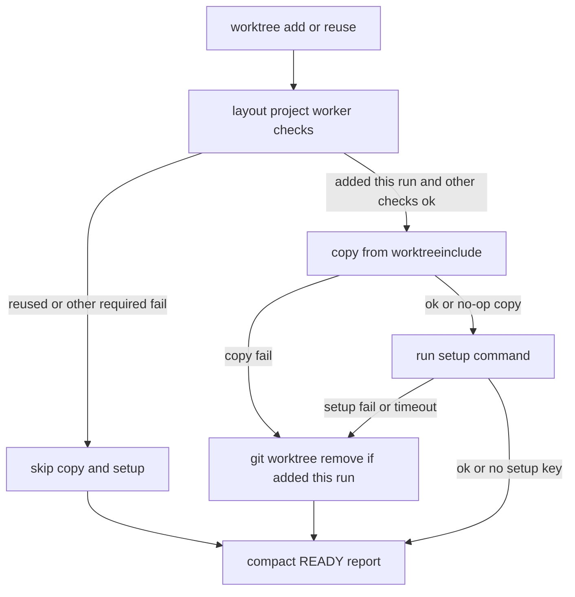

# Implementation Plan: Ready worktree local files

**Branch**: `skip` | **Date**: 2026-10-26 | **Spec**: [spec.md](./spec.md)

**Input**: Feature specification from `/specs/001-worktree-include-setup/spec.md`

**Note**: This template is filled in by the `/speckit.plan` command; its definition describes the execution workflow. Git branch is `skip`; spec directory is `specs/001-worktree-include-setup` (do not infer the spec dir from the branch name).

## Summary

Ready already creates or reuses an isolated feature worktree, but ignored local files (secrets, deps, data) stay on the invocation checkout, so later PIVS tests cannot run in isolation. After a **new** `git worktree add` — and only if no other required check has already failed — Ready copies paths allowed by a committed `.worktreeinclude` (gitignore syntax) from `REPO_ROOT` into the new tree, then optionally runs one `setup:` command from `.specify/ready.yml` in that tree (10-minute bound). Reuse skips both. Copy/setup failure blocks Ready and removes only a worktree added in this run. Compact CHECKS report outcomes with a copy file count, never paths or secret contents. Apply the same diff to both identical `ready-check.sh` / selftest twins and mention the include file and `setup:` in both Ready SKILL/AGENTS pairs.

## Technical Context

**Language/Version**: bash (`set -euo pipefail`) + existing inline Python 3 in `ready-check.sh`

**Primary Dependencies**: git, rsync (macOS openrsync OK), python3 stdlib `subprocess` for setup timeout. No new packages.

**Storage**: N/A (files in git worktrees; `.worktreeinclude` committed; `.specify/ready.yml` optional)

**Testing**: existing `ready-check.selftest.sh` (deterministic temp repos, no live network); extend both twins

**Target Platform**: macOS and Linux operator machines running the Ready gate (Cursor/Hermes)

**Project Type**: agent scripts + docs (AiNative Ready / speckit-ready twins), not an application

**Performance Goals**: copy bounded by listed paths; setup hard-stop at 600s

**Constraints**: no copied paths/contents in output; no YAML shell except top-level `setup:`; no spec writes / no ship; twin scripts byte-identical; do not symlink `node_modules` / `.venv` / `.env` back to source

**Scale/Scope**: two script copies, two selftests, four doc files (`ready` + `speckit-ready` AGENTS.md + SKILL.md)

## Constitution Check

*GATE: Must pass before Phase 0 research. Re-check after Phase 1 design.*

`.specify/memory/constitution.md` is the unfilled Specify stub (placeholder principles). Binding rules for this change are Ready `SKILL.md` / `rule.md` and the feature spec:

- Gate-only: never write spec content, never start `specs/`, never ship — **pass** (copy/setup stay inside `ready-check.sh`).
- Compact report field set unchanged — **pass** (additive CHECKS/FIXES only).
- “No arbitrary shell from YAML” — **justified exception**: FR-007 allows exactly one top-level `setup:` string; `checks:` stay `tcp`/`http`/`file_exists`/`env_var_set`. Not a per-check shell type.
- Twin-script sync — **pass** (explicit deliverable).
- No new dependencies — **pass**.

## Project Structure

### Documentation (this feature)

```text
specs/001-worktree-include-setup/
├── plan.md
├── research.md
├── data-model.md
├── quickstart.md
├── contracts/
│   ├── ready-report.md
│   └── ready-yml-setup.md
└── tasks.md              # NOT created by /speckit.plan
```

### Source Code (repository root)

```text
AiNative/docs/agents/ready/
├── AGENTS.md
├── SKILL.md
├── rule.md
└── scripts/
    ├── ready-check.sh
    └── ready-check.selftest.sh

AiNative/docs/agents/speckit-ready/
├── AGENTS.md
├── SKILL.md
└── scripts/
    ├── ready-check.sh          # must remain identical to ready/
    └── ready-check.selftest.sh # must remain identical to ready/
```

**Structure Decision**: Brownfield edit of the existing Ready gate. No new directories. `feature-loop.md` is out of required doc scope.



## Complexity Tracking

| Violation | Why Needed | Simpler Alternative Rejected Because |
|-----------|------------|-------------------------------------|
| Top-level YAML `setup:` despite “no arbitrary shell from YAML” | Install/sync after copy cannot be expressed as tcp/http/file/env checks | Per-check shell would widen the hole; spec forbids it. Skip setup entirely leaves deps-only projects untestable (US2). |

## Phase 0 / Phase 1 status

- [x] `research.md` — copy pipeline, YAML `setup:`, rollback, CHECKS, twins, timeout
- [x] `data-model.md` — include list, worktree flags, report
- [x] `contracts/ready-report.md`, `contracts/ready-yml-setup.md`
- [x] `quickstart.md` — selftest + rg + cmp
- [x] Constitution Check re-evaluated after design: same gates; `setup:` exception remains the only tracked complexity

## Implementation sketch (for tasks, not executed here)

1. Flag `worktree_added_this_run` on the two successful `git worktree add` paths.
2. Parse optional `setup:`; allow setup-only YAML without `checks:`.
3. After other required checks, if added this run and none failed: list+rsync; then setup with 600s timeout (`SPECKIT_READY_SETUP_TIMEOUT_SEC` override for selftest).
4. On copy/setup fail: `git worktree remove --force` the new tree; `READY: blocked` + FIXES.
5. CHECKS lines per [contracts/ready-report.md](./contracts/ready-report.md).
6. Selftest proving copy + rollback + reuse; copy to speckit-ready twins.
7. Document `.worktreeinclude` and `setup:` in all four AGENTS/SKILL files.
