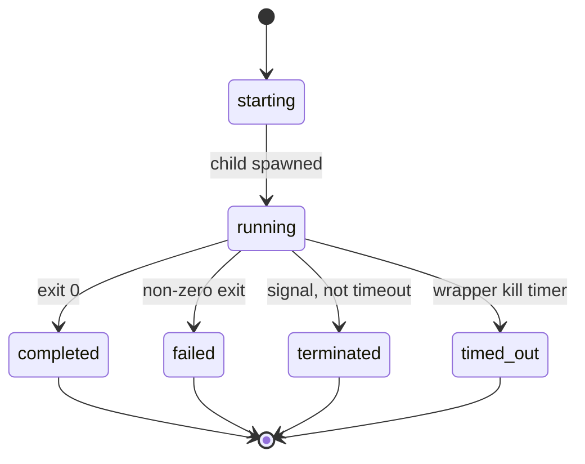

# Data model: Antigravity CLI worker backend

No database. Entities are process argv, on-disk run records, and Ready check lines.

## Wrapper spawn

Parent-facing process: `python3 …/agy-spawn.py`.

| Field | Rules |
|-------|--------|
| `--name` | Required; same sanitizer as today (`[\w.-]+`, no path seps) |
| `--cwd` | Job tree; default process cwd |
| `--model` | Required; missing → exit 2, no `agy` |
| `--effort` | Optional; forwarded to CLI when set |
| `--timeout` | Optional seconds or `Nms`; see timeout mapping |
| `--print` / `-p` | Text mode vs stream-json (both still exec `agy -p`) |
| `--scout` | Plan mode; no skip-permissions |
| `--conversation-id` | Optional → CLI `--conversation` |
| `--vertex` | Parsed; not mapped to a CLI flag |
| `--run-id` | Optional; else generated |
| prompt after `--` | Required for a real job |

**Validation**: Invalid `--name` / `--timeout` still `SystemExit` before spawn. `--self-test` does not start `agy`.

## Child argv (`agy`)

See [contracts/agy-cli-argv.md](./contracts/agy-cli-argv.md). The child is always print/headless. Prompt value is `worker-contract.md` text + blank line + job prompt.

## Run directory

Path: `.agent/antigravity/<job-name>/<run-id>/`

| File | Writer | Parent |
|------|--------|--------|
| `status.json` | Wrapper heartbeat (~2s) | Poll |
| `report.json` | Wrapper on finalize | Read after exit |
| `events.jsonl` | Raw CLI stdout lines (stream-json jobs); empty/truncated at start | **Do not ingest** |
| `stderr.log` | Child stderr | Only if debugging |
| `latest.json` | Pointer `{jobName,runId,runDir,status}` | Discover latest |

Public JSON fields stay as today except `backend` becomes `agy-cli`. See [contracts/run-dir.md](./contracts/run-dir.md).

## Lifecycle vs worker STATUS

Two independent layers (unchanged semantics).



| Layer | Source | Values |
|-------|--------|--------|
| `lifecycle` | Child process / wrapper timer | `starting`, `running`, `completed`, `failed`, `terminated`, `timed_out` |
| `workerStatus` | Assistant text regex `\bSTATUS\s*[:=]?\s*(ok\|stuck\|blocked)\b` | `ok`, `stuck`, `blocked`, or `null` |
| `reportValid` | `workerStatus is not None` | bool |

Non-zero `agy` exit → `lifecycle=failed` even if text contained `STATUS: ok`. Wrapper process exit 0 only when `lifecycle=completed`. Parent job success still requires `reportValid` and `workerStatus`.

## Assistant text (STATUS parse input)

| Mode | Source |
|------|--------|
| Wrapper `--print` | Captured CLI stdout |
| Long job (stream-json) | Reconstruct from `events.jsonl`: last `result.response`, else concatenated `agent_response` `text_delta` |

## Ready worker-runtime

Entity is a required check line, not a file.

| Input | Pass | Fail fix |
|-------|------|----------|
| `command -v agy` | binary on PATH | install/`agy` on PATH — not pip SDK |
| `agy models` | exit 0 | CLI unauthenticated or broken; API key / Vertex env insufficient |

Python SDK import is neither required nor sufficient. See [contracts/ready-worker-runtime.md](./contracts/ready-worker-runtime.md).

## Relationships

```text
Parent (orchestrate / antigravity-harness)
  └── agy-spawn.py (only launcher)
        ├── prepends worker-contract.md
        ├── execs agy -p … (stdin ignored)
        └── writes run dir
              ├── status.json / report.json  ← parent polls
              └── events.jsonl               ← wrapper STATUS parse only
Ready worker-runtime ── PATH + agy models ──► same CLI binary
```
