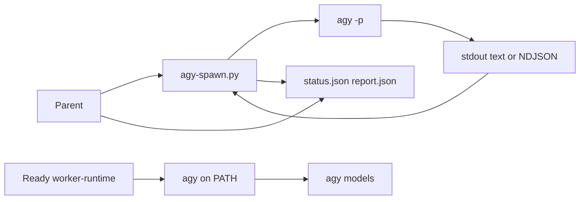

# Implementation Plan: Antigravity CLI worker backend

**Branch**: `skip` (Spec Kit feature dir `002-agy-cli-backend`) | **Date**: 2026-10-26 | **Spec**: [spec.md](./spec.md)

**Input**: Feature specification from `specs/002-agy-cli-backend/spec.md` (operator `skip`; decisions in spec **Clarifications**).

**Note**: Filled by `/speckit.plan`. Do not create `tasks.md` in this stage.

## Summary

Replace the Antigravity worker runtime (`google.antigravity.Agent` inside `agy-spawn.py`) with official CLI headless `agy -p`, matching Pi’s wrapper-execs-CLI shape. The parent still launches only `agy-spawn.py`. Edit jobs pass `--mode accept-edits --dangerously-skip-permissions`; scout passes `--mode plan` without skip-permissions. Ready `worker-runtime` gates on `agy` PATH + `agy models`, not the Python SDK. Parent monitoring files and compact stdout stay. Docs stop claiming there is no `agy -p`.

## Technical Context

**Language/Version**: Python 3 for `agy-spawn.py` (stdlib `subprocess`/`signal`; no new deps). Bash for Ready scripts. Markdown for skills/docs.

**Primary Dependencies**: Operator-installed `agy` CLI (official headless). Wrapper does not import `google.antigravity`. `python3` only to start the existing launcher. Pi harness unchanged.

**Storage**: On-disk run dirs under `.agent/antigravity/<job-name>/<run-id>/` (`status.json`, `report.json`, `events.jsonl`, `stderr.log`) plus `latest.json`.

**Testing**: `agy-spawn.py --self-test` (argv builder, timeout mapping, stream-json STATUS reconstruct, fail-closed rules) without a live `agy`. `ready-check.selftest.sh` in both ready copies. Post-implement [quickstart.md](./quickstart.md) ripgrep + selftests.

**Target Platform**: Spec Kit worker stages (Cursor / OpenCode / Hermes parent) on macOS/Linux operator machines with `agy` on PATH.

**Project Type**: CLI wrapper + Ready gate + methodology docs (single AiNative tree).

**Performance Goals**: Heartbeat `status.json` ~2s (existing). Stream-json line parse must not block parent polling.

**Constraints**: No SDK/hybrid fallback; no TUI; no `--input-format stream-json` with `-p`; no package installs or auth changes; no npm SDK; Pi untouched; skip-permissions fail-closed; stdin ignored; dual timeout when `--timeout` set; changelog only `AiNative/CHANGELOG.md`.

**Scale/Scope**: One Python wrapper, two ready-check.sh + two selftests, listed harness/orchestrate/ready docs, plus sibling SDK-runtime claims (README, feature-loop, orchestrate AGENTS/rule, Cursor command).

## Constitution Check

*GATE: Must pass before Phase 0 research. Re-check after Phase 1 design.*

`.specify/memory/constitution.md` is an **unfilled template** (placeholder principles, no ratified version). No project-specific constitution gates apply. Spec FRs are the binding constraints.

| Gate | Status |
|------|--------|
| Library-first / TDD / CLI constitution examples | N/A — template not ratified |
| New dependencies | Pass — stdlib only; operator `agy` already required by product |
| Simplicity / YAGNI | Pass — reuse Pi spawn/monitor pattern; keep wrapper filename and parent flags |
| Pi harness | Pass — FR-018 out of scope |
| No hybrid SDK | Pass — FR-017 |

**Post-design re-check**: Pass. Entities are argv, run-dir JSON, and Ready check lines. Contracts match existing parent poll surface. Timeout default discrepancy between official pages is resolved by omitting `--print-timeout` unless wrapper `--timeout` is set.

## Project Structure

### Documentation (this feature)

```text
specs/002-agy-cli-backend/
├── spec.md
├── plan.md              # this file
├── research.md
├── data-model.md
├── quickstart.md
├── contracts/
│   ├── agy-cli-argv.md
│   ├── run-dir.md
│   └── ready-worker-runtime.md
└── tasks.md             # /speckit.tasks — not created in plan stage
```

### Source (implementation targets)

```text
AiNative/
├── CHANGELOG.md
├── .cursor/commands/antigravity-harness.md
└── docs/
    ├── systems/feature-loop.md
    └── agents/
        ├── README.md
        ├── antigravity-harness/
        │   ├── agy-spawn.py
        │   ├── SKILL.md
        │   ├── rule.md
        │   ├── AGENTS.md
        │   └── worker-contract.md   # contents unchanged; prepend instead of SDK system_instructions
        ├── ready/                   # SKILL.md, scripts/ready-check.sh, ready-check.selftest.sh
        ├── speckit-ready/           # same three files, keep in lockstep
        └── speckit-orchestrate/     # SKILL.md (FR-016); AGENTS.md + rule.md for SC-007
```

**Structure Decision**: Single AiNative tree. Do not add a second wrapper. Do not rewrite host skill symlinks. `pi-harness/` is out of scope.

## Complexity Tracking

No constitution violations requiring justification.

---

## Execution plan



| ID | Work item | Primary files | FRs |
|----|-----------|---------------|-----|
| W1 | **CLI spawn in wrapper**: subprocess `agy`, stdin ignore, always `-p`, contract prepend, model/effort/timeout/conversation mappings, dual kill timer, no SDK import | `agy-spawn.py` | FR-001–006, FR-009–013, FR-017, FR-021–023 |
| W2 | **Edit vs scout argv** + skip-permissions fail-closed | `agy-spawn.py` | FR-007, FR-008 |
| W3 | **Stream-json persist + STATUS reconstruct**; keep compact stdout and report semantics | `agy-spawn.py` | FR-005, FR-013, FR-021, FR-022 |
| W4 | **Wrapper `--self-test`** for parse/argv/timeout/STATUS reconstruct without live `agy` | `agy-spawn.py` | SC-001, SC-006 |
| W5 | **Ready worker-runtime** CLI PATH + `agy models`; both script copies | `ready/scripts/ready-check.sh`, `speckit-ready/scripts/ready-check.sh` | FR-014 |
| W6 | **Ready selftests** rewrite Antigravity cases | both `ready-check.selftest.sh` | FR-015 |
| W7 | **Docs + changelog** | harness SKILL/rule/AGENTS, orchestrate SKILL (+ AGENTS/rule), both ready SKILL, README, feature-loop, Cursor command, `CHANGELOG.md` | FR-016, FR-019, FR-020 |

**Blast radius**: Antigravity worker path and Ready default backend. Pi spawn code untouched. Parent still only calls `agy-spawn.py`.

**Agent boundaries**: Implement worker edits W1–W7. Parent Ship unchanged. Do not install `agy` or change operator credentials.

**Reuse decision**: **In-repo** — copy Pi’s child stdio/timeout/report split into the existing Python wrapper; do not add libraries.

**Known current-code conflicts to resolve while implementing**:

- `agy-spawn.py` `--print` is an SDK chatter flag; it must mean `agy -p` text mode, while long jobs also pass `-p` plus stream-json.
- Ready auth currently prefers API key over `agy models`; invert to CLI-only.
- Skills say “there is no `agy -p`” and “SDK is the worker runtime”; delete those claims.
- `--timeout` omitted: SDK had no default; CLI may apply 5m or 0s depending on version — wrapper still must not invent `--print-timeout`.

---

## Acceptance criteria

| ID | Testable done-condition | Spec |
|----|-------------------------|------|
| AC-1 | Wrapper-started child argv always includes `-p`/`--print`; never a bare `agy` | SC-001, FR-003 |
| AC-2 | Parent docs/skills still spawn only `agy-spawn.py`, never `agy -p` | SC-002, FR-002 |
| AC-3 | Ready pass = PATH `agy` + `agy models`; SDK import neither required nor sufficient; FIXES never `pip install google-antigravity` | SC-003, FR-014 |
| AC-4 | Edit argv includes `--dangerously-skip-permissions` and `--mode accept-edits` | SC-004, FR-007 |
| AC-5 | Scout argv includes `--mode plan` and omits skip-permissions | SC-005, FR-008 |
| AC-6 | `status.json`/`report.json` still written; stream-json `workerStatus` from reconstructed events text; parent told not to read `events.jsonl` | SC-006, FR-013, FR-021 |
| AC-7 | Ripgrep of in-scope docs has zero “there is no `agy -p`” and zero “SDK is the worker runtime” | SC-007, FR-016 |
| AC-8 | Both ready selftests pass; case 17 fails closed without `agy` on PATH | SC-008, FR-015 |
| AC-9 | Child stdin ignored; no `--prompt-interactive`; spawn does not run `agy models` | SC-009, FR-023 |
| AC-10 | Edit spawn with rejected skip-permissions flag ends `failed`, no Ask retry, no SDK | SC-010, FR-007 |
| AC-11 | `AiNative/CHANGELOG.md` has a new SemVer entry for the switch | FR-020 |
| AC-12 | `pi-spawn.mjs` has no behavior diff | FR-018 |

---

## Validation layer

**Critic (docs + design)**: FR coverage vs W1–W7; no Pi edits; no hybrid; contracts match spec clarifications; orphan AC flagged.

**Tester (CLI/job + logic)**:

| Type | PASS | FAIL |
|------|------|------|
| logic | `python3 agy-spawn.py --self-test` prints `SELFTEST: ok` | assertion fail |
| CLI/job | both `ready-check.selftest.sh` exit 0 | case 16–19 drift |
| CLI/job | quickstart ripgrep commands | leftover SDK-runtime claims |
| CLI/job | argv unit checks in self-test (edit vs scout vs print) | missing flags |

**Heuristic risks**: installed `agy` flag drift; `--print-timeout` duration syntax; stream-json `result.response` vs deltas; dual ready copies diverging; `backend` string change if an undocumented parent greps `antigravity-sdk` (repo grep: only the wrapper).

**Proof types** (for later PIVS): TF-1–TF-5 = `logic` or `CLI/job`. No UI.

---

## Test flows

### TF-1 Happy: short print job shape (logic)

1. Build argv as wrapper `--print` without `--scout`.
2. **Expected**: contains `-p`, `--disable-slash-commands`, `--mode accept-edits`, `--dangerously-skip-permissions`; no `--output-format`; no `--input-format`; prompt starts with contract text.

### TF-2 Happy: long stream-json job shape (logic)

1. Build argv without `--print`.
2. **Expected**: `-p` and `--output-format stream-json`; STATUS reconstruct prefers `result.response`.

### TF-3 Scout vs edit (logic)

1. `--scout` argv has `--mode plan`, no skip-permissions.
2. Default argv has skip-permissions + accept-edits.

### TF-4 Ready selftests (CLI/job)

1. Run both `ready-check.selftest.sh`.
2. **Expected**: case 16/18 still fail as today; case 17 fails on missing `agy`, not SDK import; case 19 still `WORKER: antigravity`.

### TF-5 Error/edge (logic)

1. Missing `--model` → exit 2, no spawn.
2. `--timeout 2` → `--print-timeout 2s` plus wrapper timer fields set; omitted timeout → no `--print-timeout`.
3. `--conversation-id` maps to `--conversation`; `--vertex` not forwarded.
4. Non-zero child exit → `lifecycle=failed` even if stdout has `STATUS: ok`.
5. Stream-json fixture with only `text_delta` still parses `STATUS: ok`.
6. Docs rg for forbidden phrases → no matches.

### TF-6 Unchanged Pi (CLI/job)

1. `git diff` / rg: `pi-spawn.mjs` unmodified.

---

## Commit plan

Recommend implement-stage commits (parent Ship owns git unless keep-local):

1. `fix(antigravity-harness): exec agy -p from agy-spawn.py`
2. `fix(ready): gate antigravity on agy PATH and agy models`
3. `docs: describe CLI headless worker via wrapper`
4. Changelog bump in the docs commit or a dedicated `docs(changelog): 0.4.0 agy CLI worker`

Do not commit `.agent/` run dirs or secrets.
