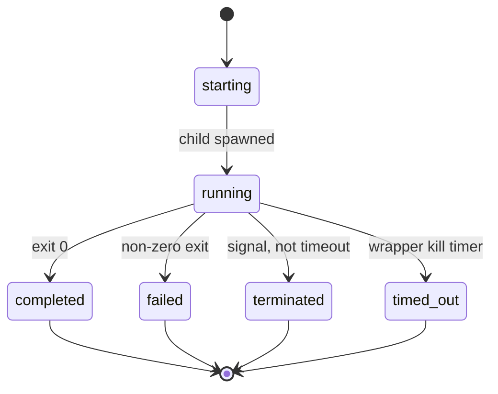

# Data model: Claude SDK worker harness

No database. Entities are worker identity, wrapper argv, child argv, on-disk run records, and Ready check lines.

## Worker backend identity

| Field | Rules |
|-------|--------|
| Canonical id | `claude` |
| Aliases | `claude-code`, `anthropic` (case-insensitive) |
| Resolution | `SPECKIT_WORKER` → `git config speckit.worker` → default `antigravity` (unchanged) |
| Ready report | `WORKER: claude` when this backend is selected |
| Override binary | `SPECKIT_CLAUDE_BIN` (default `claude`), same pattern as `SPECKIT_PI_BIN` |

Unknown values still fail Ready. Default when unset remains `antigravity`.

## Wrapper spawn

Parent-facing process: `node …/claude-spawn.mjs` (or `./claude-spawn.mjs` with shebang).

| Field | Rules |
|-------|--------|
| `--name` | Required; same sanitizer as Pi (`[\w.-]+`, no path seps). Names the run dir, **not** `claude -n`. |
| `--cwd` | Feature worktree; child cwd |
| `--model` | Required; missing → exit 2, no `claude` |
| `--effort` | Optional; forwarded when CLI accepts `--effort` |
| `--timeout` | Optional seconds or `Nms`; wrapper kill timer only |
| `--print` / `-p` | Text stdout vs stream-json (both still exec `claude -p`) |
| `--scout` | `--permission-mode plan`; no `auto` |
| `--conversation-id` | Optional → CLI `--resume <id>` |
| `--run-id` | Optional; else generated |
| prompt after `--` | Required for a real job |
| `--self-test` | No child; asserts argv/STATUS helpers |

**Validation**: Invalid `--name` / `--timeout` fail before spawn.

## Child process (`claude -p`)

See [contracts/claude-cli-argv.md](./contracts/claude-cli-argv.md). Always print/headless. Contract via `--append-system-prompt-file` (fallback `--append-system-prompt`). Job prompt is the print argument. Stdin ignored.

## Worker contract

Text of `AiNative/docs/agents/claude-harness/worker-contract.md`. Meaning matches Pi/Antigravity: one job, compact `STATUS: ok|stuck|blocked`, no unsolicited commit/push/SSH. Attached as system-prompt append, not as the only identity.

## Run directory

Path: `.agent/claude/<job-name>/<run-id>/`

| File | Writer | Parent |
|------|--------|--------|
| `status.json` | Wrapper heartbeat (~2s) | Poll |
| `report.json` | Wrapper on finalize | Read after exit |
| `events.jsonl` | Raw CLI stdout lines (stream-json); empty/truncated at start | **Do not ingest** |
| `stderr.log` | Child stderr | Debug only |
| `latest.json` | Pointer `{jobName,runId,runDir,status}` beside the job folder | Discover latest |

`backend` value: `claude-cli`. `schemaVersion`: `2`. See [contracts/run-dir.md](./contracts/run-dir.md).

## Lifecycle vs worker STATUS

Two independent layers (same as Pi/Antigravity).



| Layer | Source | Values |
|-------|--------|--------|
| `lifecycle` | Child process / wrapper timer | `starting`, `running`, `completed`, `failed`, `terminated`, `timed_out` |
| `workerStatus` | Assistant text regex `\bSTATUS\s*[:=]?\s*(ok\|stuck\|blocked)\b` | `ok`, `stuck`, `blocked`, or `null` |
| `reportValid` | `workerStatus` is not null | bool |

Non-zero `claude` exit → `lifecycle=failed` even if text contained `STATUS: ok`. Wrapper process exit 0 only when `lifecycle=completed`. Parent job success still requires `reportValid` and `workerStatus`.

Timeout kill order (when `--timeout` set): SIGINT → wait ~2s → SIGTERM → wait ~2s → SIGKILL.

## Assistant text (STATUS parse input)

| Mode | Source |
|------|--------|
| Wrapper `--print` | Captured CLI stdout |
| Long job (stream-json) | Reconstruct from `events.jsonl`: last `type=="result"` string field, else assistant text blocks, else `text_delta` |

## Edit vs scout

| Wrapper | Permission | Forbidden |
|---------|------------|-----------|
| default | `--permission-mode auto` | skip-permissions, `bypassPermissions` |
| `--scout` | `--permission-mode plan` | `auto`, skip-permissions, `bypassPermissions` |

## Ready worker-runtime

Entity is a required check line, not a file.

| Input | Pass | Fail fix |
|-------|------|----------|
| `claude` on PATH | binary found | install Claude Code CLI / PATH — not language SDK packages |
| Unattended auth | env token **or** `apiKeyHelper` in settings JSON **or** non-empty `.credentials.json` | official API-key or CLI login docs; no model probe |

See [contracts/ready-worker-runtime.md](./contracts/ready-worker-runtime.md).

## Relationships

```text
Parent (orchestrate / claude-harness)
  └── claude-spawn.mjs
        ├── writes .agent/claude/…/{status,report,events,stderr}
        └── execs claude -p (stdin ignored)
Ready worker-runtime ── PATH + auth files/env ──► same CLI binary
```
