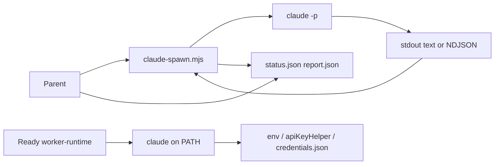

# Implementation Plan: Claude SDK worker harness

**Branch**: `claude-sdk-worker` (Spec Kit feature dir `003-claude-sdk-worker`) | **Date**: 2026-10-31 | **Spec**: [spec.md](./spec.md)

**Input**: Feature specification from `specs/003-claude-sdk-worker/spec.md` (clarifications in spec; official Claude Code docs searched during plan).

**Note**: Filled by `/speckit.plan`. Do not create `tasks.md` in this stage.

## Summary

Add a third Spec Kit Worker backend `claude` (aliases `claude-code`, `anthropic`) parallel to Pi and Antigravity. The parent still only launches a harness wrapper. The wrapper execs official Claude Code print mode (`claude -p`): short jobs text stdout, long jobs `--output-format stream-json --verbose`. Edit jobs pass `--permission-mode auto`; scout passes `--permission-mode plan`; never skip-permissions / `bypassPermissions` / default `--bare`. Ready gates on `claude` on PATH plus unattended auth evidence without a model call. Default worker stays `antigravity`. Docs and `AiNative/CHANGELOG.md` (recommend `0.6.0`) list the new backend.

## Technical Context

**Language/Version**: Node (stdlib) for `claude-spawn.mjs`. Bash for Ready scripts. Markdown for skills/docs.

**Primary Dependencies**: Operator-installed Claude Code CLI (`claude`). Wrapper does not import `@anthropic-ai/claude-agent-sdk` / `claude-agent-sdk`. `node` only to start the launcher (same as Pi). Pi and Antigravity spawn files unchanged.

**Storage**: On-disk run dirs under `.agent/claude/<job-name>/<run-id>/` (`status.json`, `report.json`, `events.jsonl`, `stderr.log`) plus `latest.json`.

**Testing**: `node …/claude-spawn.mjs --self-test` (argv builder, timeout/SIGINT order, stream-json STATUS reconstruct, fail-closed rules) without a live model. `ready-check.selftest.sh` in both ready copies. Post-implement [quickstart.md](./quickstart.md) ripgrep + selftests.

**Target Platform**: Spec Kit worker stages (Cursor / OpenCode / Hermes parent) on macOS/Linux operator machines with `claude` on PATH.

**Project Type**: CLI wrapper + Ready gate + methodology docs (single AiNative tree).

**Performance Goals**: Heartbeat `status.json` ~2s (Pi). Stream-json line parse must not block parent polling.

**Constraints**: No language-SDK/Managed Agents/TUI fallback; no `--input-format stream-json`; no default `--bare`; no default `--max-turns` / `--max-budget-usd`; no Ready version floor; stdin ignored; changelog only `AiNative/CHANGELOG.md`; default worker remains antigravity.

**Scale/Scope**: One Node wrapper + harness docs, two ready-check.sh + two selftests, orchestrate/ready/feature-loop/README/setup lists, Cursor command, changelog.

## Constitution Check

*GATE: Must pass before Phase 0 research. Re-check after Phase 1 design.*

`.specify/memory/constitution.md` is an **unfilled template** (placeholder principles, no ratified version). No project-specific constitution gates apply. Spec FRs are the binding constraints.

| Gate | Status |
|------|--------|
| Library-first / TDD / CLI constitution examples | N/A — template not ratified |
| New dependencies | Pass — Node stdlib only; operator `claude` already required by product |
| Simplicity / YAGNI | Pass — clone Pi spawn/monitor; do not extract a shared harness framework |
| Pi / Antigravity child argv | Pass — FR-018; only shared resolution strings gain `claude` |
| No hybrid SDK / Managed Agents | Pass — FR-002, FR-017 |
| Dispatcher stays parent | Pass — FR-023 |

**Post-design re-check**: Pass. Entities are argv, run-dir JSON, and Ready check lines. Contracts match existing parent poll surface. Official docs confirm flags used in argv/ready contracts. Known ceiling: Ready cannot see macOS Keychain-only login without a model call (documented in research + ready contract).

## Project Structure

### Documentation (this feature)

```text
specs/003-claude-sdk-worker/
├── spec.md
├── plan.md              # this file
├── research.md
├── data-model.md
├── quickstart.md
├── contracts/
│   ├── claude-cli-argv.md
│   ├── run-dir.md
│   └── ready-worker-runtime.md
└── tasks.md             # /speckit.tasks — not created in plan stage
```

### Source (implementation targets)

```text
AiNative/
├── CHANGELOG.md
├── .cursor/commands/claude-harness.md
└── docs/
    ├── systems/feature-loop.md
    ├── knowledge/setup/
    │   ├── cursor-setup.md
    │   └── hermes-readiness.sh
    └── agents/
        ├── README.md
        ├── claude-harness/          # NEW
        │   ├── claude-spawn.mjs
        │   ├── SKILL.md
        │   ├── rule.md
        │   ├── AGENTS.md
        │   └── worker-contract.md
        ├── ready/                   # SKILL.md, AGENTS.md, scripts
        ├── speckit-ready/           # lockstep with ready/
        └── speckit-orchestrate/     # SKILL.md, AGENTS.md, rule.md
```

**Structure Decision**: Single AiNative tree. New `claude-harness/` beside `pi-harness/` and `antigravity-harness/`. Do not rewrite host skill symlinks (`link-host-skills.sh` already links every agent folder). Do not edit `pi-spawn.mjs` / `agy-spawn.py` behavior.

## Complexity Tracking

No constitution violations requiring justification.

---

## Execution plan



| ID | Work item | Primary files | FRs |
|----|-----------|---------------|-----|
| W1 | **New wrapper**: Node spawn, stdin ignore, always `-p`, contract append-file, model/effort/resume/isolation, SIGINT→SIGTERM→SIGKILL timer, no SDK import | `claude-harness/claude-spawn.mjs` | FR-002–007, FR-010–013, FR-017, FR-021–025 |
| W2 | **Edit vs scout argv** + required-flag fail-closed; optional flag omit | `claude-spawn.mjs` | FR-008, FR-009, FR-026 |
| W3 | **Stream-json persist + STATUS reconstruct**; compact stdout | `claude-spawn.mjs` | FR-005, FR-006, FR-013, FR-021, FR-022 |
| W4 | **Wrapper `--self-test`** without live `claude` job | `claude-spawn.mjs` | SC-001, SC-006 |
| W5 | **Ready worker-runtime** PATH + auth evidence; aliases; unknown-worker FIXES | both `ready-check.sh` | FR-001, FR-014 |
| W6 | **Ready selftests** Claude PATH/auth/alias; keep 16–19 | both `ready-check.selftest.sh` | FR-015 |
| W7 | **Harness + orchestrate + setup docs + changelog 0.6.0** | `claude-harness/*`, orchestrate, both ready SKILL/AGENTS, README, feature-loop, cursor-setup, hermes-readiness, Cursor command, `CHANGELOG.md` | FR-016, FR-019, FR-020, FR-023, FR-024 |

**Blast radius**: New worker path and shared resolution lists. Pi/Antigravity child argv untouched. Parent still only calls the wrapper for Worker stages.

**Agent boundaries**: Implement worker edits W1–W7. Parent Ship unchanged. Do not install `claude` or change operator credentials. Do not commit, push, or open PRs unless a later job prompt says so.

**Reuse decision**: **In-repo** — copy Pi’s stdio/timeout/report split into a new Node wrapper; do not add libraries.

**Known current-code conflicts to resolve while implementing**:

- Ready `case` in `ready-check.sh` has no `claude` arm; unknown-worker FIXES omit `claude`.
- Orchestrate/ready/feature-loop/README still say Worker is Pi or Antigravity only.
- `hermes-readiness.sh` skill list omits `claude-harness`.
- Official future risk: `--bare` may become default for `-p`; no `--no-bare` flag today — do not invent one.
- Ready cannot detect macOS Keychain-only login; FIXES must say so.

---

## Acceptance criteria

| ID | Testable done-condition | Spec |
|----|-------------------------|------|
| AC-1 | Wrapper-started child argv always includes `-p`/`--print`; never a bare TUI `claude`; never default `--bare` | SC-001, FR-004, FR-025 |
| AC-2 | Parent docs/skills spawn only `claude-spawn.mjs`, never `claude -p` | SC-002, FR-003 |
| AC-3 | Ready pass = PATH `claude` + auth evidence; SDK packages neither required nor sufficient; FIXES never pip/npm Agent SDK as the runtime | SC-003, FR-014 |
| AC-4 | Edit argv includes `--permission-mode auto` and omits skip-permissions / `bypassPermissions` | SC-004, FR-008 |
| AC-5 | Scout argv includes `--permission-mode plan` and omits `auto` / skip-permissions | SC-005, FR-009 |
| AC-6 | `status.json`/`report.json` written; stream-json `workerStatus` from reconstructed events; parent told not to read `events.jsonl` | SC-006, FR-013, FR-021 |
| AC-7 | In-scope docs list Claude beside Pi and Antigravity; exclusive two-backend Worker claims gone | SC-010, FR-016 |
| AC-8 | Both ready selftests pass; Claude PATH-miss and auth-miss fail closed; default remains antigravity | SC-008, FR-015 |
| AC-9 | Child stdin ignored; no `--bg`/`--cloud` description/`--input-format stream-json` | SC-009, FR-004, FR-007 |
| AC-10 | Edit spawn whose CLI rejects `--permission-mode auto` ends `failed`, no Manual/SDK retry | FR-008, FR-026 |
| AC-11 | `AiNative/CHANGELOG.md` has a new SemVer entry for the backend | FR-020 |
| AC-12 | `pi-spawn.mjs` and `agy-spawn.py` have no behavior diff | FR-018 |
| AC-13 | Missing wrapper `--model` exits 2 without starting `claude` | FR-010 |
| AC-14 | Operator can switch with only `SPECKIT_WORKER` / `speckit.worker`; aliases resolve to `claude` | SC-007, FR-001 |

---

## Validation layer

**Critic (docs + design)**: FR coverage vs W1–W7; no Pi/Agy spawn edits; no hybrid SDK; contracts match clarifications and official flag names; orphan AC flagged.

**Tester (CLI/job + logic)**:

| Type | PASS | FAIL |
|------|------|------|
| logic | `node claude-spawn.mjs --self-test` prints `SELFTEST: ok` | assertion fail |
| CLI/job | both `ready-check.selftest.sh` exit 0 | case 16–19 or new Claude cases drift |
| CLI/job | quickstart ripgrep commands | leftover two-backend-only Worker claims |
| CLI/job | argv unit checks in self-test (edit vs scout vs print) | missing/forbidden flags |

**Heuristic risks**: installed `claude` flag drift; stream-json `result` field shape; dual ready copies diverging; Keychain-only auth false negative; future `--bare` default for `-p`.

**Proof types** (for later PIVS): TF-1–TF-6 = `logic` or `CLI/job`. No UI.

---

## Test flows

### TF-1 Happy: short print job shape (logic)

1. Build argv as wrapper `--print` without `--scout`.
2. **Expected**: contains `-p`/`--print`, `--permission-mode auto`, `--model`; `--append-system-prompt-file` or append fallback; no `--output-format stream-json`; no `--bare`; no skip-permissions / `bypassPermissions`; no `--input-format`; no `--bg`.

### TF-2 Happy: long stream-json job shape (logic)

1. Build argv without `--print`.
2. **Expected**: `-p` and `--output-format stream-json` and `--verbose`; STATUS reconstruct prefers last `type=="result"` text.

### TF-3 Scout vs edit (logic)

1. `--scout` argv has `--permission-mode plan`, no `auto`.
2. Default argv has `auto`, no `plan`.

### TF-4 Ready selftests (CLI/job)

1. Run both `ready-check.selftest.sh`.
2. **Expected**: 16/17 still fail as today; 18 FIXES list `claude`; 19 still `WORKER: antigravity`; new Claude PATH-miss/auth-miss fail; env-token pass; alias → `WORKER: claude`.

### TF-5 Error/edge (logic)

1. Missing `--model` → exit 2, no spawn.
2. `--timeout 2` sets wrapper timer fields; argv has no `--max-turns` / `--max-budget-usd`; omitted timeout → no wrapper-invented timer.
3. `--conversation-id` maps to `--resume`; default isolated (`--no-session-persistence` when probed present).
4. Non-zero child exit → `lifecycle=failed` even if stdout has `STATUS: ok`.
5. Stream-json fixture with only `text_delta` still parses `STATUS: ok` if no `result` line.
6. Required `--permission-mode auto` rejected → failed, no retry.

### TF-6 Unchanged sibling spawn (CLI/job)

1. `git diff` / rg: `pi-spawn.mjs` and `agy-spawn.py` unmodified.

---

## Commit plan

Recommend implement-stage commits (parent Ship owns git unless keep-local):

1. `feat(claude-harness): spawn claude -p from claude-spawn.mjs`
2. `feat(ready): gate claude on CLI PATH and unattended auth evidence`
3. `docs: list Claude as a third Spec Kit worker`
4. Changelog bump in the docs commit (`docs(changelog): 0.6.0 Claude worker`)

Do not commit `.agent/` run dirs or secrets.
