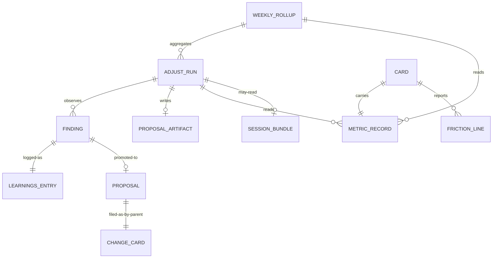

# Data model: Adjust stage (PIVS → PIVSA)

**Feature**: `specs/004-adjust-stage` | **Plan**: [plan.md](./plan.md) | **Research**: [research.md](./research.md)

Every entity below is a **document-level** construct: a block on a card, a
section in a Markdown file, or a line in a compact report. Nothing here is a
database table and nothing is parsed by a program in this change. The model
exists so the skill, the loop document, and the harness adapters describe the
same objects with the same field names.

Naming convention used below: `field` = exact token as it must appear in the
artifact. `<…>` = placeholder. `→` = "conforms to".

---

## 1. AdjustRun

One card's single Adjust execution. Lives in the proposal artifact header and
in the compact report.

| Field | Type | Rule |
|---|---|---|
| `flow_id` | string | Same `FLOW_ID` the card used; required (FR-002) |
| `card` | string | Board card id; required |
| `path` | `feature \| change \| rollup` | Per-card runs are `feature`/`change` only; `rollup` for the weekly artifact (D2, spec Assumptions) |
| `terminal_state` | `merged \| blocked \| parked \| killed \| abandoned` | The card's state at dispatch; `merged` requires a UAT pass on the same head (FR-004/FR-005) |
| `exit_checks` | `card-data`, plus `reports`, plus optional `bundle:<ref>` | Input classes actually used, in priority order (FR-009/FR-010) |
| `verdict` | `ok \| no-findings \| blocked` | `no-findings` is the explicit empty outcome (FR-018) |
| `learnings_written` | integer ≥ 0 | Count of entries appended, not count of lines |
| `proposals` | list of `Proposal` ids | `none` when empty |
| `artifact` | path \| `none` | `.ainative/adjust/<YYYY-MM-DD>-<card-id>.md` (D5) |
| `friction` | `FrictionLine` | Required in the report, never in the artifact |
| `status` | `ok \| stuck \| blocked` | Worker status; a park is `blocked` (FR-008) |

**Validation**: a run whose `verdict` is `ok` MUST have `proposals` non-empty or
`learnings_written > 0`; otherwise the verdict is `no-findings`. A run with
`exit_checks` = `card-data` only and no findings MUST say evidence was
insufficient (spec edge case 1). `artifact: none` is allowed only with
`verdict: no-findings`.

**State transitions**

```text
dispatched → reading inputs → (no findings) → no-findings ─┐
                            → (findings)    → written     ├→ reported → card completes
                            → (blocked)     → blocked ────┘
                                 ↑ attempt 2, attempt 3 ────┘  (then park: follow-up item, card completes)
```

Attempts never reopen the merged PR and never hold the card (FR-006, clarified).

---

## 2. Finding

One observation drawn from evidence. Never a file of its own — it becomes a
`LearningsEntry` and, if eligible, a `Proposal`.

| Field | Type | Rule |
|---|---|---|
| `key` | string | `<target-class>/<normalized-target-ref>/<slug>` — the identity (FR-023, D8) |
| `target_class` | `project-rules \| project-config \| ainative \| harness` | Closed set (FR-014) |
| `target_ref` | string | Normalized: repo-relative path (no line numbers), `skill:<name>`, `doc:<path>`, or `harness:<name>` |
| `slug` | string | 3–6 kebab-case words, stable across runs |
| `observation` | string | One sentence, no `|` character |
| `evidence` | list | Each item `card:<id>`, `report:<path>`, `metric:<field>=<value>`, or `transcript:<path>` |
| `cards` | list of card ids | Distinct cards the finding was seen on; drives recurrence (FR-020) |
| `first_seen` / `last_seen` | ISO date | `last_seen` ≥ `first_seen` |

**Validation**: `evidence` non-empty for anything that becomes a `Proposal`
(FR-016); an empty evidence list downgrades the finding to a learning with a
stated reason. `cards` is a set — the same card listed twice counts once.

---

## 3. LearningsEntry

An append-only line-group in `.ainative/learnings.md`.

```markdown
## <key>
- observed: <YYYY-MM-DD>
- cards: <card-id>[, <card-id>…]
- target: <target_class> → <target_ref>
- evidence: <evidence-ref>[, <evidence-ref>…]
- observation: <one sentence>
- status: learning | promoted | superseded
- promoted-by: <proposal id> (only when status is promoted)
```

Heading level: **`##`**, one block per key, matching
[contracts/proposal-artifact.md](./contracts/proposal-artifact.md) § 2 (the
learnings log) and T019 ("one `## <key>` block"). No other level is valid for a
log entry — the `###` shape appears only inside a proposal artifact's inline
`## Learnings (this run)` section, which is a per-run excerpt, not the log.

| Rule | Source |
|---|---|
| File is distinct from the rules file — evidence vs decision | FR-024 |
| Appended, never rewritten; a superseded entry keeps its lines and gains `status: superseded` | FR-023, D5 |
| `key` is unique per file; a second sighting appends to `cards` and bumps `last_seen` | FR-020 |
| Recurrence is computed by grouping entries on `key` and unioning `cards` | FR-020 |

---

## 4. Proposal / RuleProposal

A finding that met the recurrence threshold and names a merge target.

| Field | Type | Rule |
|---|---|---|
| `id` | `P<n>` | Run-local, `n` from 1 |
| `finding_key` | string | Points at the promoted `LearningsEntry` |
| `target_class` | 4-value closed set | Exactly one (FR-014) |
| `target_file` | string | File the edit lands in, or `file-class:<…>` when the class has several |
| `merge_target` | `<file>#<rule-id-or-heading>` \| `none` | Required for proposal; `none` ⇒ stays a learning (FR-021/FR-022) |
| `existing_rule_quote` | string | Verbatim text of the rule being replaced/merged; required with `merge_target` |
| `intended_edit` | string | Reviewer-usable description; must be a rewrite/merge, never "add a new section" (FR-021) |
| `evidence` | list | ≥ 1 checkable ref (FR-013) |
| `cards` | list of card ids | ≥ 2 distinct (FR-020) |
| `change_card` | card id \| `pending` | Filled by the **parent** when it files the card (FR-015) |

**Validation**: `len(set(cards)) >= 2`; `merge_target != none`;
`existing_rule_quote` non-empty; `intended_edit` must not read as an append
(a reviewer rejects "add a new rule/section/file") — this is the FR-021 test.
A proposal whose target is an AiNative skill or system doc gets
`target_file` inside AiNative and `change_card` against the AiNative repo, never
an in-place edit of the mounted copy (FR-017).

---

## 5. ChangeCard (proposal card)

The board artifact. Owned by the parent, not by Adjust.

| Field | Source |
|---|---|
| `title` | `adjust: <short observation>` |
| body `## Target` | `target_class` → `target_ref` |
| body `## Evidence` | proposal `evidence` + `finding_key` |
| body `## Intended edit` | `intended_edit` + `existing_rule_quote` |
| body `## Approval` | `pending` → `approved` \| `rejected` (operator) |
| body `## Provenance` | card id, Adjust artifact path, proposal id |

**Validation**: no Change card is filed for a `merge_target: none` finding
(FR-022); no Change card is filed by a worker (FR-015); a rejected Change card
leaves the learnings entry in place so the same finding recurs visibly rather
than being re-proposed as new (spec edge case: duplicate findings).

---

## 6. MetricRecord

The `## Metrics` block appended to the card by the parent at terminal state.
Wire format: [contracts/metrics-block.md](./contracts/metrics-block.md).

| Field | Type | Rule |
|---|---|---|
| `path` | `feature \| change \| job` | Required |
| `terminal` | `merged \| blocked \| parked \| killed \| abandoned` | Required; its timestamp anchors the roll-up week (D2) |
| `closed_at` | ISO-8601 UTC | Required |
| `loops.converge` | integer ≥ 0 \| `n/a` | `n/a` when the path lacks the stage (D1). On the `job` path (`ready → route → one worker → ship`) **all four** loop-back fields are `n/a` and `uat.outcome` is `not_run` |
| `loops.critic` | integer ≥ 0 \| `n/a` | Same |
| `loops.tester` | integer ≥ 0 \| `n/a` | Same |
| `loops.pr_review` | integer ≥ 0 \| `n/a` | Same |
| `uat.outcome` | `pass \| fail \| not_run` | `not_run` for job/abandoned-before-ship (FR-026) |
| `uat.rounds` | integer ≥ 0 | Rounds attempted |
| `uat.reasons` | list of closed-set ids | Required when `outcome: fail`; each may carry `uat: r<n>` |
| `uat.notes` | quoted operator words | Required when `reasons` includes `other` |
| `tokens.input` / `tokens.output` / `tokens.total` | integer \| `unknown` | Never `0` as a stand-in for missing (FR-027) |
| `cost_usd` | number \| `unknown` | Same |
| `wall_time_active` | duration \| `unknown` | Excludes human-gated park time |
| `boundary` | string | One line: which dispatches the numbers cover and what is unavailable today (FR-027) |

**Closed UAT failure reason set** (FR-026):
`missing-feature`, `wrong-behavior`, `broken-ui`, `error-crash`,
`missing-evidence`, `env-setup`, `scope-mismatch`, `docs-wrong`, `other`.
`other` requires `uat.notes`.

**Validation**: every field present in every block, with `unknown`/`n/a` rather
than omission — a missing field would make "no friction" and "not measured"
indistinguishable (FR-011). Derivable from board dispatch history + reports
only (FR-029).

---

## 7. WeeklyRollup

The `job`-path card (and its artifact) that aggregates one ISO week.
Wire format: [contracts/rollup-card.md](./contracts/rollup-card.md).

| Field | Rule |
|---|---|
| `week` | `YYYY-Www`, ISO week, Mon–Sun UTC (D2) |
| `inputs` | The week's Adjust runs (terminal timestamp in week) + their cards' Metric blocks |
| `ranking` | Target classes/refs ordered by accumulated friction, each line showing the count and the card count |
| `recurring` | Proposals seen in earlier weeks whose Change card is not approved, with the weeks seen |
| `gaps` | Weeks with no records, late arrivals, `n/a`-heavy stages, missing `FRICTION` lines |
| `proposals` | Same `Proposal` shape as a per-card run |
| `skipped` | Not a field — skipping the card is an operator decision; absence of a card is not a record (FR-032) |

**Validation**: an empty week produces a roll-up whose `ranking` is empty and
whose `gaps` names the empty week; it never invents findings (FR-032).

---

## 8. SessionBundle

Optional drill-down input. Shape defined in
[contracts/session-bundle.md](./contracts/session-bundle.md); location per
adapter (D10).

| Field | Rule |
|---|---|
| `worker_prompt` | The exact one-step prompt handed to the worker |
| `worker_transcript` | Path or store reference; `unavailable` allowed |
| `subagent_transcripts` | List; may be empty |
| `usage` | tokens / cost / turns as the adapter reports them |
| `completeness` | `complete \| partial \| unavailable` + one-line reason |
| `pointer` | How Adjust was pointed at the bundle (path/id) |

**Validation**: a partial bundle may support a proposal but the proposal says
the drill-down was partial (FR-035); no proposal may rest only on a bundle —
card data or a report must first show the anomaly (FR-009, input priority 3).

---

## 9. FrictionLine

One line at the end of every worker report. Grammar:
[contracts/friction-line.md](./contracts/friction-line.md).

| Part | Rule |
|---|---|
| `target_class` | One of the four (FR-014/FR-040) |
| `observation` | One sentence, no `|` |
| `evidence_ref` | Checkable by the parent: card id, path, report id, metric |
| `none` form | Exactly `FRICTION: none` — the clean-run default |

**Validation**: present in every documented report contract (FR-040) and in
every worker skill's report section as a pointer (FR-041). Absence in an older
artifact means **unknown** (FR-011), so Adjust's report must distinguish
"no friction reported" from "no report".

---

## Relationships



**Cardinalities that carry a rule**: `FINDING → PROPOSAL` is `0..1` and only
when distinct cards ≥ 2; `PROPOSAL → CHANGE_CARD` is exactly 1 and the card is
filed by the parent; `ADJUST_RUN → METRIC_RECORD` is read-only in every
direction (Adjust never writes metrics).

---

## Invariants

1. **Proposals only.** No entity in this model is a rule, config, skill, or
   adapter edit. The only writes are the learnings log and the proposal artifact
   (FR-012, FR-015).
2. **No merge coupling.** No field of `AdjustRun` is an input to any merge,
   release, or dependent-card decision (FR-006, SC-007).
3. **Unknown ≠ zero.** Every metric field admits `unknown`; every loop-back field
   admits `n/a`; a missing `FRICTION` line means unknown (FR-011, D1).
4. **One home per fact.** The metrics block is defined once and referenced by
   both Adjust and the roll-up; the `FRICTION` grammar is stated once and
   referenced by every worker (FR-040/FR-041, D7).
5. **Identity is the key, not the wording.** Recurrence and duplicate-proposal
   detection group on `finding_key`, so rewording does not create a new finding
   and identical wording on two targets does not merge them (FR-020, D8).
