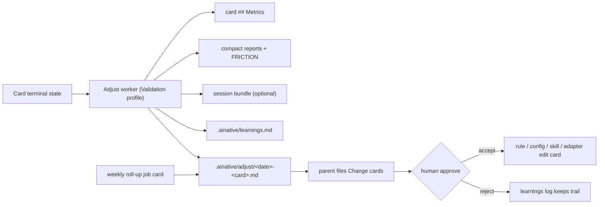

# Implementation Plan: Adjust stage (PIVS → PIVSA)

**Branch**: `adjust-stage` (Spec Kit feature dir `004-adjust-stage`) | **Date**: 2026-11-26 | **Spec**: [spec.md](./spec.md)

**Input**: Feature specification from `specs/004-adjust-stage/spec.md` (clarifications recorded in spec § Clarifications; two deferred items resolved in [research.md](./research.md) D1 and D2).

**Note**: Filled by `/speckit.plan`. Do not create `tasks.md` in this stage.

## Summary

Add the fifth loop phase, **Adjust**, to the AiNative methodology. Every feature
and change card that reaches a terminal state — merged after a UAT pass, or
closed without a merge (blocked, parked, killed, abandoned) — dispatches one
Adjust worker. Adjust reads the card's numbers, the workers' compact reports,
and their new `FRICTION:` lines, then writes (a) learnings entries for
single-observation findings and (b) rule proposals for findings that recur on
≥2 distinct cards, each naming the existing rule it replaces or merges into.
Every proposal becomes a Change card filed by the **parent**; Adjust never
edits rules, never edits the board, and never gates merge.

Deliverable is documentation only: a new `docs/agents/adjust/` skill folder,
the loop document updated to PIVSA (graph, state table, card paths, compact
reports with `FRICTION`, metrics, roll-up), a per-card metrics definition, a
weekly cross-card roll-up definition, session-bundle sections in the harness
adapters, and a `CHANGELOG.md` entry. The "tests" are doc-review checks a tester
executes by grep and inspection, listed in [quickstart.md](./quickstart.md) and
in § Test flows below.

## Technical Context

**Language/Version**: Markdown (AiNative docs), Bash 3.2-compatible `grep`/`rg`/`awk` one-liners for the doc-review checks. No application code, no Node, no Python.

**Primary Dependencies**: None added. Existing docs conventions: `AGENTS.md` / `SKILL.md` / `rule.md` agent folder shape, `[<gate>: <id>]` validator-ID style, `_skills/` library, `docs/systems/*` methodology documents.

**Storage**: Two new project-repo artifacts, both under `.ainative/` in the managed project: `learnings.md` (append-only findings log) and `adjust/<YYYY-MM-DD>-<card-id>.md` (per-run proposal artifact), plus `.ainative/adjust/<YYYY>-W<ww>-rollup.md` (weekly). Per-card numbers live in a `## Metrics` block on the card, not in a file.

**Testing**: Doc-review checks — `rg` assertions over `AiNative/docs/**` and `AiNative/CHANGELOG.md` (harness paths absent from methodology docs, `FRICTION` present in every documented report contract, `PIVS`-only statements gone), plus human-inspection tabletop scenarios against the acceptance criteria. No runtime tests; no historical card is required to reproduce metrics, but one tabletop exercise uses a synthetic card.

**Target Platform**: The AiNative methodology tree (`AiNative/docs`, `AiNative/CHANGELOG.md`), read by the Hermes control plane read-only at `/opt/data/mnt/AiNative`, linked into host skill directories by `docs/knowledge/setup/link-host-skills.sh`.

**Project Type**: Methodology/documentation set (single AiNative tree). No library, no CLI, no service.

**Performance Goals**: N/A. The only quantitative goal is prose-level: the loop document must answer the five Adjust questions (where it runs per path, what it reads, what it writes, whether it can block merge, how a proposal is filed) without sending the reader to another file for the *policy* (links to contracts are allowed for formats).

**Constraints**: Harness neutrality — tool paths, hook names, database tables, and container mounts appear only in `docs/agents/*-harness/` or `docs/knowledge/setup/harness.md`, never in `docs/systems/` or the `adjust` skill (FR-036). One gate per concern — the recurrence threshold and merge-target requirement are checked only in the `adjust` skill's procedure/`rule.md`; `ready`, `task-groomer`, and `harness.md` are not touched for those checks (FR-042). Adjust output is proposals only and never blocks merge (FR-006, FR-012). Stage name is `Adjust`, never `learn` (FR-003). No transcript-parsing scripts (spec § Assumptions).

**Scale/Scope**: 1 new agent folder (3 files), 1 loop document rewritten in 6 sections, 1 metrics definition + 1 roll-up definition (both inside `feature-loop.md` unless length forces a sibling doc — see D6), `FRICTION` added to **12 documented report contracts** (the twelfth is the job-skills line; `ship`'s line is emitted by the parent, not a worker) plus **17** worker docs (13 skill docs and the four harness `SKILL.md` prompt templates), the tester's inlined `_skills/test-execution` fragment (covered through the tester doc, checked by path), and 4 harness `worker-contract.md` files, **4** harness-adapter sections (three `*-harness` docs plus Hermes `harness.md`; `antigravity-harness` stays optional per D11), ~14 `PIVS → PIVSA` consistency edits plus 11 relinked `#pivsa-mapping` anchors in 8 files, 1 changelog entry.

## Constitution Check

*GATE: Must pass before Phase 0 research. Re-check after Phase 1 design.*

`.specify/memory/constitution.md` is an **unfilled template** (placeholder principles, no ratified version). No project-specific constitution gates apply. The spec's FRs plus the AiNative conventions named in the task are the binding constraints.

| Gate | Status |
|------|--------|
| Library-first / TDD / CLI constitution examples | N/A — template not ratified |
| New dependencies / new scripts | Pass — no scripts, no parsers (task out-of-scope; spec § Assumptions) |
| Harness neutrality (FR-036, SC-006) | Pass — mechanics confined to adapters + `harness.md`; TF-4 greps the added lines (pre-existing runtime-ownership mentions are out of scope) |
| Gate ownership (FR-042) | Pass — no check added to `ready`, `task-groomer`, or the install gate; the two Adjust checks live only in `adjust/rule.md` |
| Compact-report + validator-ID conventions (FR-040, FR-043) | Pass — `FRICTION` follows the existing one-section-stated format; Adjust finding IDs use `[adjust: A<n>]`, report-only |
| Stage naming (FR-003) | Pass — `Adjust`; `learn` remains the `job`-path skill for `learn` cards, untouched |
| Non-blocking merge (FR-006, SC-007) | Pass — no new gate; Adjust trigger is the terminal state, park is a follow-up item |
| Changelog discipline (FR-044) | Pass — one `[Unreleased]` block, existing format |

**Post-design re-check**: Pass. Entities are documents, a card block, and two `.ainative/` artifacts — no runtime surface. Contracts ([contracts/](./contracts/)) restate each FR's observable shape; the only cross-document coupling (metrics block written by the parent, read by Adjust and by the roll-up) is defined once in `contracts/metrics-block.md` and referenced, not duplicated.

## Project Structure

### Documentation (this feature)

```text
specs/004-adjust-stage/
├── spec.md
├── plan.md              # this file
├── research.md          # Phase 0 output
├── data-model.md        # Phase 1 output
├── quickstart.md        # Phase 1 output — doc-review + tabletop checks
├── contracts/
│   ├── friction-line.md        # FRICTION grammar + where it appears
│   ├── adjust-report.md        # Adjust skill folder + compact report
│   ├── proposal-artifact.md    # proposal file, learnings log, finding key
│   ├── metrics-block.md        # per-card ## Metrics block + closed UAT reasons
│   ├── rollup-card.md          # weekly roll-up card shape + ranking
│   └── session-bundle.md       # bundle contents each adapter must document
└── tasks.md             # /speckit.tasks — not created in plan stage
```

### Source (implementation targets, all under `AiNative/`)

```text
AiNative/
├── CHANGELOG.md                                    # UPDATE [Unreleased]
└── docs/
    ├── systems/
    │   ├── feature-loop.md                         # REWRITE: graph, paths, PIVSA, compact reports, metrics, roll-up
    │   ├── agentic-system.md                       # UPDATE: PIVS → PIVSA (line ~239)
    │   ├── validation-layer.md                     # UPDATE: PIVSA Validation (lines ~3, ~127)
    │   ├── jev/README.md                           # UPDATE: PIVSA loop (line ~3)
    │   └── README.md                               # UPDATE: feature-loop row mentions Adjust
    ├── knowledge/setup/harness.md                  # UPDATE: Hermes session bundle + caveats
    └── agents/
        ├── README.md                               # UPDATE: table row + methodology line
        ├── adjust/                                 # NEW
        │   ├── SKILL.md                            # inputs, procedure, output contract, report
        │   ├── AGENTS.md                           # purpose, when, inputs/outputs
        │   └── rule.md                             # recurrence threshold, merge-target, stop conditions
        ├── critic/{AGENTS.md,SKILL.md,rule.md}      # UPDATE: FRICTION + PIVSA
        ├── tester/{AGENTS.md,SKILL.md,rule.md}      # UPDATE: FRICTION + PIVSA
        ├── pr-reviewer/SKILL.md                    # UPDATE: FRICTION
        ├── ready/AGENTS.md                         # UPDATE: FRICTION
        ├── route-work/AGENTS.md                    # UPDATE: FRICTION
        ├── change/SKILL.md                         # UPDATE: FRICTION
        ├── learn/SKILL.md                          # UPDATE: FRICTION
        ├── prd-writer/SKILL.md                     # UPDATE: FRICTION (job worker)
        ├── project-bootstrapper/SKILL.md           # UPDATE: FRICTION (job worker)
        ├── proposal-writer/SKILL.md                # UPDATE: FRICTION (job worker)
        ├── speckit-ready/SKILL.md                  # UPDATE: FRICTION (job skill; its output IS the ready report)
        ├── server-setup/SKILL.md                   # UPDATE: FRICTION (job skill report contract)
        ├── speckit-orchestrate/SKILL.md            # UPDATE: tell workers to emit FRICTION
        ├── claude-harness/{SKILL.md,worker-contract.md}   # UPDATE: session bundle + caveats, FRICTION
        ├── cursor-harness/{SKILL.md,worker-contract.md}   # UPDATE: same
        ├── pi-harness/{SKILL.md,worker-contract.md}       # UPDATE: same
        └── antigravity-harness/worker-contract.md         # UPDATE: FRICTION only (see research D11)
```

**Structure Decision**: Single AiNative tree, no new top-level docs. `adjust/`
sits beside `critic/`, `tester/`, `change/`, `learn/` and follows the template
shape copied from `docs/agents/template/`. Adjust's *policy* lives in its own
folder; the loop document gains the stage, the phase mapping, the metrics
definition, and the roll-up definition, so "what the loop is" stays in one
file. No host symlink work is needed (`link-host-skills.sh` links every folder),
but `docs/agents/README.md` must gain the row or the linker/docs drift.

## Complexity Tracking

No constitution violations requiring justification. One deliberate weight
increase: `feature-loop.md` gains two definitions (metrics, roll-up) instead of
two new system docs — chosen to keep one graph document (spec § Assumptions),
accepted risk is file length (~366 → ~520 lines).

---

## Execution plan



| ID | Work item | Primary files | FRs |
|----|-----------|---------------|-----|
| W1 | **Adjust skill folder**: `SKILL.md` (inputs in priority order, 8-step procedure, proposal/learnings output contract, `no-findings` path, compact report), `AGENTS.md` (purpose/triggers/I-O), `rule.md` (recurrence ≥2 distinct cards, merge-target required, proposals-only, non-blocking, 3-attempts-then-park, findng-key rules, validator-ID rules, `no findings` stop) | `docs/agents/adjust/{SKILL,AGENTS,rule}.md` | FR-001, FR-002, FR-008, FR-009, FR-010, FR-011, FR-012–FR-024, FR-043 |
| W2 | **Loop document — stage + graph**: state graph, graph string, state table row (`adjust`, kind AiNative, worker yes, after `uat`/merge and on non-merging terminal states, never gates), card-path rows for `feature` and `change`, explicit "job path has no per-card Adjust" line, end-of-path rule addition | `docs/systems/feature-loop.md` | FR-004, FR-005, FR-006, FR-007, FR-037 |
| W3 | **PIVSA mapping**: five phases, Adjust defined as the fifth, relationship to merge stated, remove any four-phase claim; propagate the phase name to `agentic-system.md`, `validation-layer.md`, `jev/README.md`, `agents/README.md`, `.cursor/commands/{critic,tester}.md` descriptions, and the `PIVS` intro/description lines in `docs/agents/{critic,tester}/{AGENTS,SKILL}.md`; rename the heading plainly to `## PIVSA mapping` and retarget every inbound `#pivs-mapping` link to `#pivsa-mapping` (8 files, 11 links — enumerated in T004). The `systems/README.md` edit is the feature-loop row text mentioning Adjust (FR-037), **not** a PIVSA rename — that file contains no PIVS text | `feature-loop.md` § PIVSA mapping + the linked docs + the anchor retargets | FR-037, FR-038, FR-039, SC-010 |
| W4 | **Compact reports + FRICTION**: one stated grammar (`FRICTION: <target-class> \| <one-sentence observation> \| <evidence-reference>`, clean run emits exactly `FRICTION: none`), the four target classes, the rule that missing lines mean *unknown*, and the line appended to all 12 documented report contracts (ready, route, specify/clarify/plan/tasks/analyze, implement, converge, critic, tester feature, tester change, pr-reviewer, ship, adjust, job skills) | `feature-loop.md` § Compact reports | FR-040, FR-011 |
| W5 | **FRICTION in worker skill docs**: one line each in the worker's own report section pointing at the grammar, never restating it — the 13 docs (ready, route-work, critic, tester, change, learn, pr-reviewer, prd-writer, project-bootstrapper, proposal-writer, `speckit-ready`, `server-setup`, `speckit-orchestrate`), plus the tester's inlined `_skills/test-execution` fragment (covered through the tester doc, checked by path), plus the `Report:` bullet of the four harness `SKILL.md` prompt templates (`claude`, `cursor`, `pi`, `antigravity`) ⇒ **17 counted worker docs** (21 with the 4 `worker-contract.md` files) | `docs/agents/*/{SKILL,AGENTS}.md`, `docs/agents/claude-harness/SKILL.md`, `docs/agents/cursor-harness/SKILL.md`, `docs/agents/pi-harness/SKILL.md`, `docs/agents/antigravity-harness/SKILL.md`, `docs/agents/_skills/test-execution/SKILL.md` | FR-041, SC-002 |
| W6 | **Metrics definition**: per-card `## Metrics` block (home + writer + when), loop-back counts per stage with the D1 counting rule, UAT outcome with closed reason set + operator words, tokens/cost/wall time with accounting boundary and `unknown` rule, before/after comparison rule and window | `feature-loop.md` § Per-card metrics (+ `contracts/metrics-block.md`) | FR-025–FR-029, SC-005 |
| W7 | **Weekly roll-up**: ISO-week boundary, control-plane scheduling ownership, job-card artifact with `SKILL: adjust` + `STEP: rollup`, input set, ranking with visible counts, recurring-unaccepted reporting, skip semantics, evidence-gap output | `feature-loop.md` § Weekly roll-up (+ `contracts/rollup-card.md`) | FR-030–FR-032, SC-008 |
| W8 | **Harness session bundles**: bundle contents + location + how Adjust is pointed at it + ≥1 caveat each, in `claude-harness`, `cursor-harness`, `pi-harness`, and `knowledge/setup/harness.md` (Hermes); partial-bundle degrade rule stated once per doc | adapter docs + `harness.md` | FR-033–FR-036, SC-006 |
| W9 | **Agent registry + changelog**: `agents/README.md` row (`adjust` — Feature-loop Adjust), methodology line PIVSA, "Add a new agent" note that Adjust is loop-state #5; `CHANGELOG.md` `[Unreleased]` `Added`/`Changed` entries per FR-044 | `docs/agents/README.md`, `CHANGELOG.md` | FR-001, FR-044 |
| W10 | **Doc-review evidence sheet**: run TF-1…TF-12, record command + output in the PR body walkthrough so the operator can re-run them (no file committed; PR body only) | PR body (parent, at ship) | SC-001–SC-010 |

**Blast radius**: exactly the three entries of the **File allowlist** below —
`AiNative/docs/**`, `AiNative/CHANGELOG.md`, and two `.cursor` `description:`
lines. No `scripts/`, no `*.mjs`, no `ready-check.sh`, no board code, no
`personalAgent`. `docs/agents/learn/` keeps its name and meaning — only its
report section gains one line. `antigravity-harness` gets the `FRICTION` line and
an optional session-bundle paragraph (D11); if that paragraph is skipped, no FR
fails.

**File allowlist — single owner of "which files may change"**: this is the only
place the change set is enumerated. TF-11 (quickstart), T030 (tasks), the tester
DoD, and the Prerequisites block **point here and restate nothing**; if they ever
disagree with this list, this list wins.

1. `AiNative/docs/**` — new and updated methodology and agent docs.
2. `AiNative/CHANGELOG.md` — the `[Unreleased]` entry.
3. Exactly two frontmatter lines: the `description:` of
   `AiNative/.cursor/commands/critic.md` and `AiNative/.cursor/commands/tester.md`
   (`PIVS` → `PIVSA`). These are **allowed because W3/T004 mandate them** — a
   status check that forbids them makes TF-1 and TF-11 mutually unsatisfiable.
   The wrapper bodies stay byte-identical; any body hunk is a failure.

Everything else is out of bounds: no `AiNative/scripts/**` change (including
`ready-check.sh`), no `*.mjs`/`*.py` parser, no pre-created `.ainative/` file or
directory, no host symlink, no edit under `personalAgent/`, `.specify/`, or
`.pi/`.

**Agent boundaries**: Implement worker writes W1–W9 and reports; the parent
ships; critic and tester review the documents. Adjust itself is *not* run in
this feature (no worker loop is wired, spec § Assumptions) — the deliverable is
the definition. Do not install symlinks, do not edit `personalAgent`, do not
touch `.specify/` or `.pi/`.

**Reuse decision**: **In-repo, no new infra** — reuse the `docs/agents/template/`
folder shape, the existing compact-report section style, and the existing
`[tester: flow-2]` / `[critic: C1]` validator-ID convention with a new
`[adjust: A<n>]` gate prefix. Reuse `validation-layer.md#model-selection` for
the Validation-profile requirement instead of restating profiles.

**Known current-code conflicts to resolve while implementing**:

- `feature-loop.md` currently asserts the loop *is* PIVS in exactly three places, and they are **not** heading/bullet/graph: the opening paragraph (~line 4, "PIVS agent definitions are stages on"), the `## PIVS mapping` heading (~line 254), and the sentence under it (~line 256, "The loop above is the detailed form of PIVS:"). `rg -n 'PIVS\b' AiNative/docs/systems/feature-loop.md` returns those three lines and nothing else — all three must move together or the doc self-contradicts, and T003 names line ~256 explicitly so it is not missed.
- `docs/agents/critic/SKILL.md` heading says "Compact report (PIVS, feature path)" and `.cursor/commands/{critic,tester}.md` frontmatter says "during PIVS Validation" — the `.cursor` files are wrappers; change the description only, never fork the body.
- `docs/agents/README.md` says "Methodology: PIVS".
- `docs/agents/{critic,tester}/AGENTS.md` and `{critic,tester}/SKILL.md` (description) also read PIVS — six lines in total, renamed in T013.
- Renaming the `## PIVS mapping` heading to `## PIVSA mapping` changes the GitHub slug to `#pivsa-mapping`, so the old anchor dies. Keeping a literal `(PIVS)` in the heading would preserve the anchor but is itself a `PIVS\b` match, which TF-1 forbids — so **do not** keep it. Rename plainly and retarget every inbound link. The real inbound set is **8 files / 11 links**: `docs/systems/agentic-system.md:239`, `docs/systems/validation-layer.md:3`, `docs/systems/agentic-coding.md:3,6,87`, `docs/agents/README.md:105`, `docs/agents/critic/AGENTS.md:5`, `docs/agents/tester/AGENTS.md:5`, `docs/agents/pr-reviewer/AGENTS.md:9`, `docs/agents/prd-writer/SKILL.md:467,473` (proved with `rg -n '#pivs-mapping' AiNative/`). All 11 are updated in T004; after the change `rg -n '#pivs-mapping' AiNative/` returns nothing and `rg -n '#pivsa-mapping' AiNative/` returns the 11.
- `validation-layer.md` names the live graph as `critic → tester → ship → pr-review → uat` — it must gain `→ adjust`.
- The gate-ownership table in `harness.md` must **not** gain an Adjust row (Adjust is a stage, not a gate); only the session-bundle section changes there.
- No `.ainative/` directory exists in AiNative today; the skill defines the path and creates the log on first finding. Do not pre-create empty files in this feature.

---

## Acceptance criteria

| ID | Testable done-condition | Spec |
|----|-------------------------|------|
| AC-1 | `docs/agents/adjust/` exists with `SKILL.md` (`name: adjust`), `AGENTS.md`, `rule.md`; `README.md` table lists it; folder states inputs (priority order), procedure, output contract, stop conditions, compact report | FR-001, FR-002 |
| AC-2 | The state graph, graph string, state table, and both card-path rows contain `adjust`; the mapping reads PIVSA with Adjust as the fifth phase; no statement remains that the loop is four phases | FR-037, FR-038, FR-039, SC-010 |
| AC-3 | Adjust is documented as running after UAT+merge on feature/change **and** on blocked/parked/killed/abandoned cards; one sentence says the trigger is the terminal state, so no new card state is needed | FR-004, FR-005, FR-006 |
| AC-4 | Every documented report contract in `feature-loop.md` § Compact reports carries `FRICTION`, and the grammar + `FRICTION: none` default are stated exactly once | FR-040, SC-002 |
| AC-5 | Every worker skill doc that describes a report points at the `FRICTION` grammar in one line; no worker doc documents a report without it | FR-041, SC-002 |
| AC-6 | Adjust output is proposals only: skill says it writes no rule/config/skill/adapter/board; the parent files Change cards from the proposal artifact; a `no findings` run is an explicit reported outcome | FR-012, FR-015, FR-018 |
| AC-7 | Every proposal line carries exactly one target class from the closed four and ≥1 checkable evidence ref; a proposal without evidence becomes a learning | FR-013, FR-014, FR-016 |
| AC-8 | The recurrence rule (≥2 distinct cards, key-based) and the merge-target rule (must name an existing rule; additive-only is rejected; otherwise stays a learning) are stated in `adjust/rule.md` and checked nowhere else | FR-019–FR-024, FR-042 |
| AC-9 | `## Metrics` block is defined with home, writer, and timing; loop-back counts per stage usable on feature and change paths (absent stages recorded `n/a`, never `0`); UAT closed reason set; tokens/cost/wall time with boundary and `unknown`; before/after comparison rule and window | FR-025–FR-029, SC-005 |
| AC-10 | Weekly roll-up defined: ISO-week boundary, scheduling owner, job-card artifact, input set, ranking with counts, recurring-unaccepted line, skip semantics, evidence-gap output | FR-030–FR-032, SC-008 |
| AC-11 | Four adapters each document a session bundle (contents, location, how Adjust is pointed at it) and ≥1 caveat; partial-bundle degrade rule stated; no harness path/hook/table appears in `docs/systems/**` or `adjust/SKILL.md` | FR-033–FR-036, SC-006 |
| AC-12 | `CHANGELOG.md` `[Unreleased]` records the stage, the PIVSA rename, `FRICTION`, the metrics definition, the roll-up, the adapter bundle notes, and the learnings-vs-rules rule | FR-044 |
| AC-13 | Adjust finding IDs use `[adjust: A<n>]` and appear only in report/`FINDINGS` lines, never as source-refs (`FR-###`, `US#/AC#`, `plan:`, `Constitution`) | FR-043 |
| AC-14 | Nothing in the deliverable makes Adjust a merge gate, and no `ready`/`task-groomer`/install-gate check is added or changed | FR-006, FR-042, SC-007 |

---

## Validation layer

**Critic (documents)**: FR coverage vs W1–W10; FR-036 harness-neutrality grep; FR-042 gate ownership (the two rules in exactly one file); FR-014 closed target set used consistently in the skill, the `FRICTION` grammar, and the proposal contract; AC-1…AC-14 traced to a document location; orphan acceptance criteria flagged.

**Tester (CLI/job + logic)**: every check below is a command plus a reading. No
UI, API, or runtime proof applies. Expected evidence for the PR body is the
command and its output, per [quickstart.md](./quickstart.md).

| Type | PASS | FAIL |
|------|------|------|
| CLI/job | `rg -l 'PIVS\b' AiNative/docs AiNative/CHANGELOG.md` returns only `AiNative/docs/systems/agentic-coding.md` (historical) and `AiNative/CHANGELOG.md` (history) | any live doc still reads PIVS as the loop name |
| CLI/job | `rg -c 'FRICTION' AiNative/docs/systems/feature-loop.md` ≥ 13 (1 grammar statement + 12 contract blocks, the twelfth being the job-skills line) and every contract block contains it | a contract block without the line |
| CLI/job | Added-line neutrality: `git diff -U0 AiNative/docs/systems AiNative/docs/agents/adjust \| rg '^\+' \| rg -n '(claude\|cursor\|pi \|~/.pi\|~/.cursor\|~/.claude\|state\.db\|kanban\.db\|/opt/data/mnt)'` returns nothing (only paths **introduced by this feature** are in scope; the three pre-existing runtime-ownership mentions of the mount are untouched) | harness path or table leaked into methodology by this change |
| CLI/job | `rg -n 'adjust' AiNative/docs/systems/feature-loop.md` shows graph string, table row, both path rows, metrics, roll-up | missing placement |
| CLI/job | `rg -n 'learnings\|recurrence\|merge target' AiNative/docs/agents/adjust/rule.md` shows both rules once, and `rg` finds no copy in `ready/`, `task-groomer/` | rule duplicated into another gate |
| logic | Tabletop US1: synthetic card with tester FAIL ×2 and a `FRICTION` line → documented output is one proposal with evidence, one target, Change card | prose cannot produce that output |
| logic | Tabletop US3: findings A (1 card), B (1 card), C (2 cards) → A,B learnings; C promoted and names its merge target | threshold unstated or additive allowed |
| logic | Metrics reproduction: fill one synthetic card's `## Metrics` from board data + reports only | a field needs transcript access |
| logic | Roll-back/verify: skip-section reading — operator answers the five questions from `feature-loop.md` + `adjust/` alone | requires a third file for policy |

**Heuristic risks**: (1) `FRICTION` restated per worker → drift; mitigate by
pointer-only lines (W5) and TF-3. (2) PIVSA rename done in `feature-loop.md`
only → SC-010 fails; W3 enumerates all touched docs. (3) Metrics defined but
not derivable (needs Hermes aggregation) → AC-9 requires `unknown` be an
allowed value and the boundary be stated. (4) Roll-up week boundary ambiguity →
D2 fixes ISO week + UTC + terminal-state anchor. (5) Proposal artifacts
vanishing with the worktree → D5 fixes the home and the parent-side
persistence. (6) Antigravity left without a bundle → accepted gap, D11.

**Proof types** (for later PIVSA): TF-1…TF-12 = `CLI/job` (grep assertions) or
`logic` (inspection/tabletop). No UI.

---

## Test flows

Each flow is executable by a tester with only the repo: run the command, then
apply the stated reading. Full expected output conventions are in
[quickstart.md](./quickstart.md).

### TF-1 PIVSA everywhere (CLI/job)

1. `rg -n 'four phases|PIVS\b' AiNative/docs AiNative/CHANGELOG.md`
2. **Expected**: matches only in `docs/systems/agentic-coding.md` (historical write-up) and `CHANGELOG.md` history/entries that describe the rename. No live system or agent doc states the loop is four phases.
3. `rg -n 'PIVSA' AiNative/docs/systems/feature-loop.md AiNative/docs/systems/agentic-system.md AiNative/docs/systems/validation-layer.md AiNative/docs/systems/jev/README.md AiNative/docs/agents/README.md AiNative/docs/systems/README.md`
4. **Expected**: ≥1 hit per file.

### TF-2 Adjust in the graph and paths (CLI/job + logic)

1. `rg -n 'adjust' AiNative/docs/systems/feature-loop.md`
2. **Expected**: hit in the state-graph block, the graph string, the state table row, the `feature` path row, the `change` path row, the PIVSA mapping, the metrics section, the roll-up section.
3. **Read**: the `feature` row ends `→ uat → adjust`; the `change` row ends `→ uat → adjust`; the `job` row says the job path has no per-card Adjust and why.

### TF-3 FRICTION coverage and single statement (CLI/job)

1. `rg -n 'FRICTION' AiNative/docs/systems/feature-loop.md`
2. **Expected**: exactly one definition paragraph (grammar + four target classes + `FRICTION: none`), then one `FRICTION` mention inside each of the 12 contract blocks — **13** occurrences in the file in total (1 grammar statement + 12 blocks).
3. `rg -c 'FRICTION' AiNative/docs/agents/*/SKILL.md AiNative/docs/agents/*/AGENTS.md AiNative/docs/agents/*/worker-contract.md`
4. **Expected**: a hit for every worker that documents a report (ready, route-work, critic, tester, change, learn, pr-reviewer, prd-writer, project-bootstrapper, proposal-writer, `speckit-ready`, `server-setup`, `speckit-orchestrate`), for the four harness `SKILL.md` prompt templates (`claude`/`cursor`/`pi`/`antigravity` — their `Report:` bullet), and for `claude`/`cursor`/`pi`/`antigravity` `worker-contract`. Count these and compare with the contract list from step 2 — the contract count is 12 (the twelfth being the job-skills line), the worker-doc count is **17** (13 skill docs + 4 harness `SKILL.md`) and the prompt-contract count is 4, so the glob returns **21** hits. The tester's inlined fragment `AiNative/docs/agents/_skills/test-execution/SKILL.md` is not in the glob (two levels down) and is checked on its own path — it is covered through the tester doc that inlines it.

### TF-4 Harness neutrality — introduced paths only (CLI/job)

1. Added-lines check (this is the FR-036 assertion; pre-existing lines are out of scope):

```bash
git diff -U0 AiNative/docs/systems AiNative/docs/agents/adjust | rg '^\+' | \
  rg -n '(/opt/data/mnt|state\.db|kanban\.db|~/.claude|~/.cursor|~/.pi|SubagentStop|agent_transcript_path|task_runs)'
```

2. **Expected**: no output — the feature adds no harness mechanic to the methodology docs.
3. Baseline check, so a new leak is still visible next to the old ones:

```bash
rg -n '/opt/data/mnt' AiNative/docs/systems
```

4. **Expected**: exactly the three pre-existing runtime-ownership lines — `feature-loop.md:99`, `feature-loop.md:365`, `agentic-system.md:196`. Any fourth hit, or any hit in `docs/agents/adjust/`, is a failure.
5. `rg -ni 'session bundle' AiNative/docs/agents/claude-harness AiNative/docs/agents/cursor-harness AiNative/docs/agents/pi-harness AiNative/docs/knowledge/setup/harness.md`
6. **Expected**: ≥1 hit in each of the four, and each hit's section names contents, location, how Adjust is pointed at it, and a caveat. The match is **case-insensitive on purpose**: T025–T028 mandate the heading `## Session bundle`, so a capital-S match is the normal PASS.

### TF-5 Proposals only, parent files (logic)

1. Read `docs/agents/adjust/SKILL.md` § Output and `rule.md`.
2. **Expected**: writes limited to the proposal artifact and the learnings log; an explicit prohibition on editing rules/config/skills/adapters and on writing to the board; the parent's filing duty stated; `ADJUST: no-findings` documented with the evidence checked.

### TF-6 Recurrence and merge target (logic)

1. Read `docs/agents/adjust/rule.md`.
2. **Expected**: threshold is *2 or more distinct cards* counted by finding key; the key shape `<target-class> / <normalized target ref> / <short slug>`; a rule proposal MUST name the existing rule it replaces or merges into; additive-only is rejected; no merge target → stays a learning with the reason in the report.
3. `rg -n 'recurrence|merge target' AiNative/docs/agents/ready AiNative/docs/agents/task-groomer`
4. **Expected**: no output (gate ownership, FR-042).

### TF-7 Metrics derivable without transcripts (logic)

1. Read `feature-loop.md` § Per-card metrics. Take the synthetic card in [quickstart.md](./quickstart.md) § Scenario B.
2. **Expected**: converge/critic/tester/pr-review counts fill in from dispatch history; `n/a` used for stages the path lacks; UAT reason chosen from the closed set with the operator's words kept; tokens/cost/wall time filled or `unknown`; the boundary line states what is covered.

### TF-8 Test flows exist for the definitions (logic)

1. Read `feature-loop.md` § Weekly roll-up and `contracts/rollup-card.md`.
2. **Expected**: ISO week Mon–Sun UTC, anchor = card terminal timestamp; control plane owns the trigger; artifact is a `job` card with `SKILL: adjust`, `STEP: rollup`, `week:`; ranking shows counts; recurring-unaccepted proposals listed, not re-filed; empty week → evidence-gap report.

### TF-9 Error/edge (logic)

1. Card abandoned before any worker ran (no reports): documented outcome is `ADJUST: no-findings` with "evidence insufficient", no artifact proposal, card completes.
2. Card predating `FRICTION`: missing lines are treated as unknown and the report says so.
3. Two workers blame each other: both frictions recorded and cited, no winner picked without a number.
4. Proposal targeting AiNative while the mount is read-only: filed as a card against the AiNative repo.
5. Adjust blocked/parks three times: card completes, park recorded as follow-up item, merge untouched.

### TF-10 Changelog (CLI/job)

1. `rg -n 'Adjust|PIVSA|FRICTION|roll-up|learnings' AiNative/CHANGELOG.md`
2. **Expected**: an `[Unreleased]` entry naming the stage, the rename, `FRICTION`, the metrics definition, the roll-up, the adapter bundle notes, and the learnings-vs-rules rule.

### TF-11 No forbidden artifacts (CLI/job)

1. `git status --porcelain` and `git diff --stat` in `AiNative/`.
2. **Expected**: only the plan's **File allowlist** (the single owner of the change set) — `docs/**`, `CHANGELOG.md`, and the two `.cursor/commands/{critic,tester}.md` `description:` frontmatter lines. No `scripts/`, no `*.mjs`/`*.py` parser, no `.ainative/` file pre-created, no `.cursor/commands/*` body changes.

### TF-12 Operator answers the five questions (logic)

Give a reader only `feature-loop.md` and `docs/agents/adjust/`. They must answer, without a third file: where Adjust runs on each path, what it may read, what it may write, whether it can block merge, and how a proposal gets filed.

**Expected**: all five answered from those two places (formats may be linked). One "I'd need to check the skill/harness doc" on any of the five is a failure.

---

## Commit plan

Recommended implement-stage commits (parent Ship owns git unless `keep-local`):

1. `docs(adjust): add the Adjust stage skill`
2. `docs(feature-loop): add Adjust to the graph and make the loop PIVSA`
3. `docs: require a FRICTION line in every worker report`
4. `docs(feature-loop): define per-card metrics and the weekly Adjust roll-up`
5. `docs(harness): document session bundles for Adjust drill-down`
6. `docs(changelog): record PIVSA and the Adjust stage`

Do not commit `.agent/` run dirs, `.specify/`, or `.pi/`.
